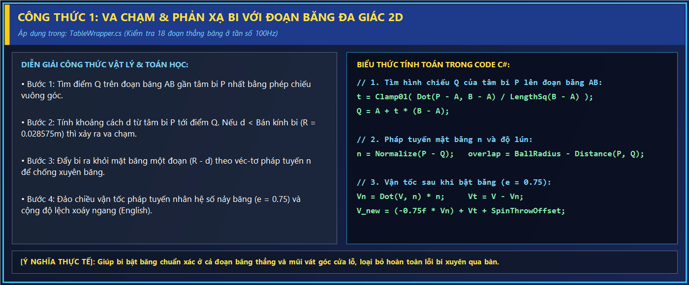
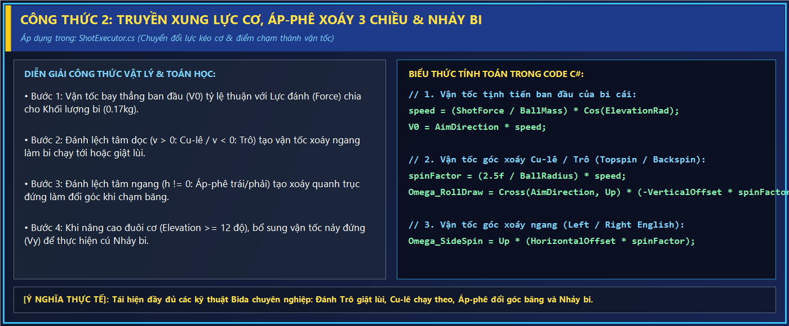
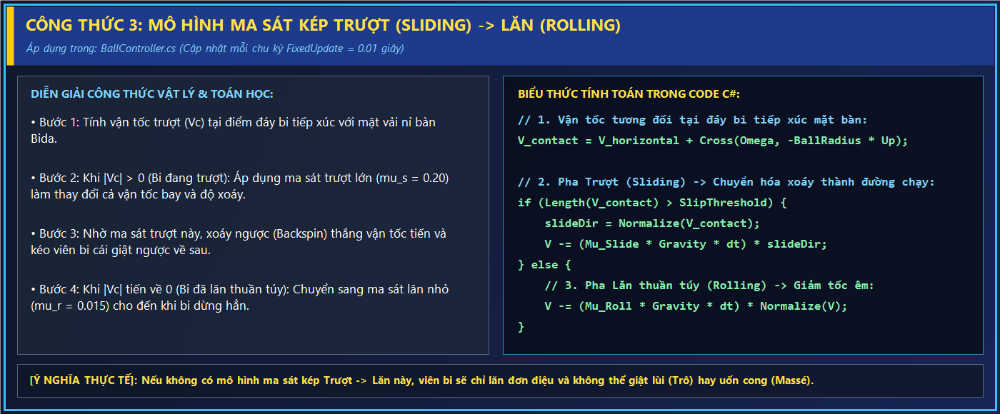
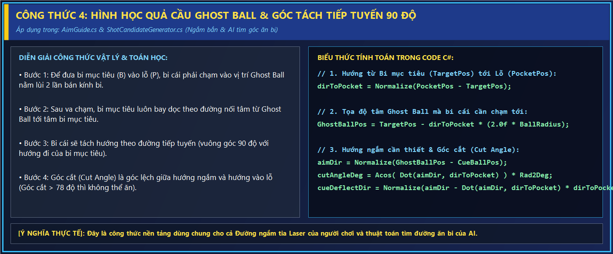
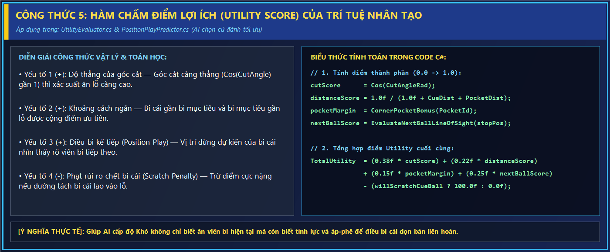

# TÀI LIỆU KỸ THUẬT & HƯỚNG DẪN TOÀN TẬP DỰ ÁN GAME 3D
# **"CƠ THỦ ĐẠI CHIẾN — CUE CLASH 3D" (8-BALL BILLIARDS ARENA)**

- **Tên đề tài / Sản phẩm**: Game Bida 8 Bi 3D Trực Tuyến & Trí Tuệ Nhân Tạo — **Cơ Thủ Đại Chiến (Cue Clash 3D)**
- **Nền tảng phát triển**: Unity 2022.3.62f3 LTS (High Definition Render Pipeline — HDRP)
- **Ngôn ngữ lập trình**: C# (.NET Standard 2.1)
- **Công nghệ mạng**: Photon Unity Networking 2 (PUN 2) & Photon Realtime Cloud
- **Đường dẫn mã nguồn**: `D:\TAI_LIEU_HOC_TAP\DoAnTotNghiep\Code\Game_Bida_3D`
- **Đường dẫn bản Build phát hành**: `D:\TAI_LIEU_HOC_TAP\DoAnTotNghiep\Game_Build\Co_Thu_Dai_Chien.exe`

---

## MỤC LỤC TỔNG QUAN
1. **PHẦN 1: TOÀN BỘ CHỨC NĂNG TRONG GAME**
2. **PHẦN 2: CÁC THÀNH PHẦN & CÁCH THỨC TẠO TỪNG CHỨC NĂNG (HƯỚNG DẪN TÁI HIỆN TỪNG BƯỚC)**
3. **PHẦN 3: CÁC CÔNG NGHỆ SỬ DỤNG TRONG GAME**
4. **PHẦN 4: KIẾN TRÚC PHẦN MỀM TRONG GAME**
5. **PHẦN 5: CÁC LUỒNG XỬ LÝ TRONG GAME (EXECUTION WORKFLOWS)**
6. **PHẦN 6: DANH MỤC TOÀN BỘ MÃ NGUỒN, KIỂM THỬ & CÂU HỎI BẢO VỆ ĐỒ ÁN TỐT NGHIỆP**

---

# PHẦN 1: TOÀN BỘ CHỨC NĂNG TRONG GAME

Game **Cơ Thủ Đại Chiến (Cue Clash 3D)** là một trò chơi mô phỏng bộ môn Bida Lỗ 8 Bi (WPA 8-Ball Pool) dưới góc nhìn 3D chân thực, kết hợp đầy đủ các chế độ thi đấu đơn, đấu máy AI, đấu 2 người cùng máy và đấu trực tuyến qua mạng Internet. Toàn bộ hệ thống chức năng của game được chia thành **14 phân hệ chức năng chính** dưới đây:

---

### 1.1. Phân hệ Khởi động (Boot Splash Screen) & Khởi tạo Hệ thống
- **Màn hình chào (Boot Splash UI)**:
  - Hiển thị biểu tượng và tên thương hiệu **🎱 CƠ THỦ ĐẠI CHIẾN — ĐẤU TRƯỜNG BIDA 8 BI 3D** (hoặc **🎱 CUE CLASH 3D — 8-BALL BILLIARDS ARENA** khi ở chế độ Tiếng Anh) với hiệu ứng đổ bóng, thanh tiến trình nạp dữ liệu (`LoadingBar`) mượt mà và dòng trạng thái khởi tạo thời gian thực.
- **Tự động nạp cấu hình & Dịch vụ nền (`GameBootstrap`)**:
  - Tự động áp dụng cấu hình đồ họa, âm lượng và ngôn ngữ đã lưu trong `PlayerPrefs`.
  - Khởi tạo các dịch vụ tồn tại xuyên suốt vòng đời ứng dụng (`DontDestroyOnLoad`): Quản lý âm thanh (`AudioManager`), Quản lý phiên đấu (`GameSession`), Quản lý đa ngôn ngữ (`LocalizationManager`) và Quản lý kết nối mạng (`NetworkManager`).

---

### 1.2. Phân hệ Sảnh Chính 3D (Interactive 3D Lobby) & Cá nhân hóa
- **Không gian nền 3D sống động (`LobbyCameraOrbit`)**:
  - Thay vì dùng ảnh nền 2D tĩnh, sảnh chính sử dụng chính căn phòng Bida 3D HDRP với góc máy quay quỹ đạo tròn mềm mại (`Orbit Camera`) kết hợp dao động hình sin theo phương đứng quanh bàn Bida.
- **Quản lý Hồ sơ Cơ thủ (`PlayerProfile`)**:
  - Cho phép người chơi đặt và lưu tên nhân vật (Nickname) tối đa 18 ký tự.
  - Chọn ảnh đại diện (Avatar) từ thư viện 6 chân dung cơ thủ 3D (`AvatarLibrary`).
- **Tùy biến Bàn thi đấu (`TableSelectorPopupUI` & `TableThemeApplier`)**:
  - Cho phép người chơi chọn **5 màu thảm nỉ bàn Bida VIP** có ảnh xem trước trực quan:
    1. **Xanh Dương (Tournament Blue)**
    2. **Xanh Lá (Classic Green)**
    3. **Tím Hoàng Gia (Royal Purple)**
    4. **Đỏ Rượu Vang (Burgundy Red)**
    5. **Xám Tro Hiện Đại (Slate Grey)**
  - Tự động áp dụng màu vải nỉ cho cả bàn 3D ở sảnh chờ và bàn thi đấu trong trận.
- **Trình phát Nhạc nền Đa bài hát (`MusicTrackCarouselUI`)**:
  - Cho phép chuyển đổi qua lại giữa 4 bản nhạc nền BGM chất lượng cao hoặc chế độ phát ngẫu nhiên ngay trong Cài đặt.
- **Hỗ trợ Đa ngôn ngữ Tức thì (`LocalizationManager`)**:
  - Chuyển đổi tức thời giữa **Tiếng Việt (VI)** và **Tiếng Anh (EN)** cho toàn bộ giao diện Sảnh, Luật chơi, Cài đặt và HUD trong trận mà không cần khởi động lại game.

---

### 1.3. Bốn Chế độ Chơi (4 Game Modes)
1. **Đấu với Máy — PvE vs AI (`GameMode.VsAI`)**:
   - Người chơi đối đầu với AI thông minh ở 3 cấp độ khó có thẻ bài minh họa riêng (`DifficultyCardUI`):
     - **Dễ (Easy)**: AI có sai số góc ngắm `±2.5°`, sai số lực `±18%`, chỉ tính toán ăn bi đơn giản, không dùng cơ nhảy hoặc a-băng phức tạp.
     - **Trung Bình (Medium)**: AI có sai số góc `±0.9°`, sai số lực `±8%`, biết tính đường chạy bi cái sang bi tiếp theo và biết đánh bi an toàn (Safety).
     - **Khó (Hard / Master)**: AI có độ chính xác cao (`±0.18°`), sử dụng đầy đủ kỹ thuật áp-phê điều bi (`PositionPlayPredictor`), đánh giấu cái (`SafetyShotGenerator`) và đánh bật băng (`KickShotPlanner`) khi bị che đường ngắm.
2. **Chơi 2 Người Cùng Máy — PvP Local 1v1 (`GameMode.PassAndPlay`)**:
   - Hai người chơi luân phiên sử dụng chuột và bàn phím trên cùng một máy tính để thi đấu đối kháng trực tiếp theo đúng chuẩn luật quốc tế.
3. **Đấu Trực Tuyến — PvP Online 1v1 (`GameMode.Online`)**:
   - Kết nối tới máy chủ đám mây **Photon Cloud** với chỉ báo trạng thái mạng thời gian thực (`NetworkStatusIndicatorUI`).
   - Hỗ trợ **3 phương thức ghép phòng** (`OnlineRoomUI`):
     - **Tìm Trận Nhanh (Quick Match)**: Tự động tìm phòng đang mở hoặc tạo phòng công khai mới nếu chưa có phòng chờ.
     - **Tạo Phòng Riêng (Create Room)**: Sinh mã phòng ngẫu nhiên gồm 6 ký tự chữ và số (ví dụ: `A8K92P`), cho phép bấm nút **Copy Mã Phòng** để gửi cho bạn bè.
     - **Vào Phòng Bằng Mã (Join by Code)**: Nhập mã phòng 6 ký tự để vào thẳng bàn của bạn bè.
   - **Phòng chờ Online**: Hiển thị thông tin Chủ phòng (Host) và Khách (Guest), trạng thái **Sẵn Sàng (Ready)** của khách và nút **Bắt Đầu Trận Đấu (Start Match)** của chủ phòng.
4. **Tập Luyện Tự Do — Free Practice (`GameMode.FreePractice`)**:
   - Không giới hạn thời gian lượt, không chuyển lượt sang đối thủ, cho phép bấm phím **`B`** bất kỳ lúc nào để cầm bi cái đặt vào vị trí mong muốn nhằm luyện tập các thế bi khó, kỹ thuật trô/cu-lê/nhảy bi.

---

### 1.4. Nghi thức Đầu trận: Xếp Khuôn Bi & Đua Bi Giành Quyền Đề-pa (Lag For Break)
- **Hoạt ảnh Xếp Khuôn Tam Giác (`RackIntroSequence`)**:
  - Đầu trận đấu, khuôn tam giác gỗ đặt 15 quả bi mục tiêu từ từ được nhấc lên mượt mà kèm âm thanh đặt khuôn, trong khi bi số 1 nằm ở đỉnh khuôn trên điểm Foot Spot và bi số 8 bắt buộc nằm ở chính giữa khuôn.
- **Đua Bi Giành Quyền Đề-pa (`LagForBreakController`)**:
  - Đúng chuẩn thi đấu WPA chuyên nghiệp: Hai cơ thủ đặt bi dọc đường bếp (Head String), đánh bi chạm băng cuối bàn (Foot Cushion) rồi dội ngược về gần băng đầu bàn (Head Cushion).
  - Tự động kiểm tra các lỗi phạm quy khi đua bi: Bi rơi xuống lỗ, bi không chạm băng cuối, bi chạm băng cuối nhiều hơn 1 lần, bi vượt sang phần bàn đối phương hoặc không qua vạch bếp.
  - Hiển thị **nhãn đo khoảng cách thời gian thực (`cm`)** lơ lửng phía trên từng viên bi (`BuildFloatingDistancePill`) và thông báo kết quả cơ thủ chiến thắng giành quyền đề-pa.
  - Hỗ trợ cả 3 chế độ: Đua bi 2 người cùng máy, Đua bi với AI (AI tự tính lực đua chuẩn) và Đua bi trực tuyến 2 người qua mạng Photon.

---

### 1.5. Điều khiển Cơ 3D, Ngắm Bắn Ghost Ball, Thanh Lực, Áp-phê & Nâng Cơ
- **Xoay góc ngắm 360° chuẩn xác (`PlayerInputController`)**:
  - Giữ chuột trái kéo ngang trên bàn hoặc nhấn phím `A`/`D` (Mũi tên Trái/Phải) để xoay cơ.
  - Giữ phím **`Shift`** khi xoay để bật chế độ **Ngắm Vi Chỉnh (Fine Aim)** giảm tốc độ xoay xuống 8 lần giúp căn các đường cắt mỏng ở khoảng cách xa.
- **Đường Ngắm Tia Laser & Bóng Ma Ghost Ball (`AimGuide`)**:
  - Tự động quét hình cầu (`SphereCast`) dọc hướng ngắm để hiển thị:
    - Đường đi của bi cái tới điểm chạm.
    - Quả cầu **Ghost Ball** tại đúng tâm va chạm.
    - **Véc-tơ tách hướng** của bi mục tiêu (dựa trên pháp tuyến mặt cầu tại điểm chạm) và véc-tơ lệch hướng tiếp tuyến của bi cái sau va chạm.
    - Đổi màu cảnh báo trực quan (Xanh hợp lệ / Đỏ khi ngắm vào bi của đối thủ hoặc bi 8 khi chưa dọn hết nhóm bi).
- **Thanh Lực Kéo Cơ (`PowerBarUI` & `CueController`)**:
  - Kéo thanh trượt lực bên trái màn hình hoặc giữ phím `Space` để kéo lùi cây cơ 3D ra sau theo tỷ lệ lực `0% → 100%`, thả ra để cây cơ lao tới truyền xung lực vào bi cái.
- **Chỉnh Tâm Đánh Áp-phê 2D (`CueBallContactSelector` & `CueBallSpinWidgetUI`)**:
  - Bấm vào biểu tượng bi cái góc dưới phải (hoặc giữ phím `S`) để mở bảng chọn điểm chạm đầu cơ trên mặt bi cái trong vòng tròn bán kính an toàn (`maxOffset = 0.8f`):
    - Đánh trên tâm (**Topspin / Cu-lê**): Bi cái chạy nối theo sau khi chạm bi mục tiêu.
    - Đánh dưới tâm (**Backspin / Trô**): Bi cái giật lùi ngược lại sau khi chạm bi mục tiêu.
    - Đánh lệch trái/phải (**Left/Right English / Áp-phê ngang**): Bi cái đổi góc phản xạ khi chạm băng.
- **Chỉnh Góc Nâng Cơ 3D (`CueElevationSelector` & `CueElevationUI`)**:
  - Cho phép nâng đuôi cơ từ **`0°` đến `75°`**:
    - Góc nâng `12° – 35°` + lực mạnh: Thực hiện **Cú Nhảy Bi (Jump Shot)** vượt qua bi chắn.
    - Góc nâng `35° – 75°` + áp-phê ngang: Thực hiện **Cú Đánh Cong (Massé Shot)** uốn cong quỹ đạo bi cái trên mặt bàn.

---

### 1.6. Hệ thống Vật lý Bida 3D Chuyên sâu (`100Hz`)
- **Mô phỏng ma sát kép (Trượt → Lăn)**:
  - Khi bi mới bị đánh, vận tốc tiếp xúc tại đáy bi khác 0 nên bi chịu **ma sát trượt (`μ_s = 0.20`)** làm thay đổi đồng thời vận tốc tịnh tiến và vận tốc góc cho đến khi đạt trạng thái lăn không trượt, sau đó chuyển sang **ma sát lăn (`μ_r = 0.015`)**.
- **Va chạm Băng Đa Giác 18 Đoạn Chính Xác (`TableWrapper`)**:
  - Bàn Bida được trích xuất biên dạng thành **6 đường gấp khúc đa giác 2D** (gồm mũi băng vát góc và thành băng thẳng) giúp loại bỏ hoàn toàn hiện tượng bi xuyên băng (tunneling) ở tốc độ cao và tái hiện chính xác hiện tượng "nhả bi / nuốt bi" ở cửa lỗ.
- **Hiệu ứng Vật lý Lỗ Bida (`PocketDetector`)**:
  - Tự động phát hiện khi tâm bi vượt qua mép lỗ, tạo lực hút trọng trường kéo bi rơi nghiêng vào lòng rọ thay vì biến mất đột ngột.

---

### 1.7. Bộ Luật Bida 8 Bi Quốc Tế WPA (`Wpa8BallRuleEngine`) & Gọi Lỗ Bi 8
- **Thực thi đầy đủ các quy tắc WPA 8-Ball**:
  - **Luật Cú Đề-pa (Break Shot)**: Phải có ít nhất 1 bi mục tiêu rơi xuống lỗ hoặc ít nhất **4 bi mục tiêu chạm băng**, nếu không sẽ tính là cú phá bi phạm quy. Nếu ăn bi số 8 ngay trong cú đề-pa thì không bị xử thua mà bi số 8 được **đặt lại lên điểm Foot Spot** (`respotEightBall`).
  - **Luật Bàn Mở (Open Table)**: Sau cú đề-pa, bàn ở trạng thái Mở cho đến khi một cơ thủ đánh rơi hợp lệ một viên bi Trơn (`1–7`) hoặc Khoang (`9–15`) trong lượt đánh thường để xác lập nhóm bi.
  - **Luật Đánh Hợp Lệ & Lỗi Phạm Quy (Fouls)**:
    - Lỗi không chạm bi nào (`CueBallMissedAll`).
    - Lỗi chạm sai nhóm bi đầu tiên (`WrongFirstContact`).
    - Lỗi không có bi rơi lỗ và không có bi nào chạm băng sau va chạm đầu tiên (`NoRailAfterContact`).
    - Lỗi bi cái rơi xuống lỗ (`Scratch`).
    - Lỗi bi văng khỏi mặt bàn (`BallJumpedOffTable`).
  - **Luật Gọi Lỗ Bi Số 8 (`CallShotUI` & `EightBallPocketPredictor`)**:
    - Khi cơ thủ đã ăn hết 7 bi nhóm của mình và đến lượt đánh bi số 8, hệ thống tự động dự đoán lỗ mục tiêu theo hướng ngắm (`EightBallPocketPredictor`) hoặc cho phép click chọn trực tiếp vào 1 trong 6 lỗ trên bàn (`CallShotUI`).
    - Xử lý chính xác các kịch bản Thắng/Thua ở bi số 8: Ăn bi 8 đúng lỗ đã gọi → **Thắng**; Ăn bi 8 khi chưa dọn hết nhóm bi, ăn bi 8 sai lỗ gọi, hoặc vừa ăn bi 8 vừa phạm lỗi (như chết bi cái) → **Thua ngay lập tức**.

---

### 1.8. Hệ thống Đặt Bi Cái Trong Tay (`BallInHandController`)
- Khi đối phương phạm lỗi, cơ thủ hiện tại nhận quyền **Đặt Bi Trong Tay (Ball In Hand)**:
  - **Trong vùng Bếp (Behind Head String)**: Áp dụng khi lỗi xảy ra ở cú đề-pa.
  - **Toàn mặt bàn (Full Table)**: Áp dụng cho các lỗi trong lượt đấu thông thường.
- Hỗ trợ kéo thả bi cái bằng chuột trực tiếp trên mặt bàn 3D, tự động kiểm tra khoảng cách tối thiểu tới các bi khác (`> 2 × BallRadius`) và đổi màu vòng tròn chỉ báo (Xanh khi vị trí hợp lệ / Đỏ khi bị chồng lấp với bi khác).

---

### 1.9. Hệ thống Giao tiếp Trực tuyến (Text Chat, Emoji & Voice Chat)
- **Chat Văn bản & Biểu tượng cảm xúc (`OnlineChatUI`)**:
  - Khung chat thu gọn/mở rộng trong trận đấu trực tuyến với thông báo tin nhắn chưa đọc, hỗ trợ gõ tiếng Việt và bảng chọn nhanh các câu giao tiếp / Emoji.
- **Đàm thoại Giọng nói Thời gian thực (`OnlineVoiceChatManager` & `VoiceUIWidgets`)**:
  - Thu âm từ Microphone với tần số lấy mẫu `8000 Hz`, đóng gói mỗi `0.25s`, nén không suy hao bằng `GZipStream` và truyền qua sự kiện mạng Photon (`EventCode 155`), tích hợp bộ đệm chống giật (`Jitter Buffer`) và nút bật/tắt Mic + Loa ngay trên HUD.

---

### 1.10. Hệ thống Camera, HUD Esports, Bảng Điểm TV 3D & Khán Giả Cổ Vũ
- **5 Chế độ Camera (`CameraDirector`)**:
  - Chuyển đổi linh hoạt bằng phím **`C`** hoặc nút Camera trên HUD:
    1. **Aiming View (Góc ngắm chuẩn sau lưng cơ)**
    2. **Overhead View (Góc nhìn thẳng đứng từ trần xuống mặt bàn)**
    3. **Spectator / Broadcast View (Góc máy truyền hình quan sát toàn bàn khi bi đang lăn)**
    4. **Ball-In-Hand View (Góc nhìn cao hỗ trợ đặt bi cái)**
    5. **Free Orbit View (Góc xoay tự do quan sát bàn)**
- **Giao diện HUD Esports & Thông báo Trượt (`GameplayHUD`, `TurnSlideBannerUI`, `FoulPopupUI`)**:
  - Thanh Header hiển thị Avatar, Tên, Nhóm bi (Trơn/Khoang), 7 ô trạng thái bi còn lại của mỗi người chơi (`BallTrackerUI`) và đồng hồ đếm ngược lượt đánh `30 giây` (`TurnTimerUI`).
  - Bảng điểm truyền hình 3D gắn trên màn hình TV trong phòng Bida (`TvScoreboardDisplay`) cập nhật tên và tỷ số trực tiếp trong không gian 3D.
  - Nhân vật khán giả 3D cổ vũ xung quanh bàn với các hoạt ảnh vỗ tay, ăn mừng khi cơ thủ ghi điểm.

---

# PHẦN 2: CÁC THÀNH PHẦN & CÁCH THỨC TẠO TỪNG CHỨC NĂNG (HƯỚNG DẪN TÁI HIỆN TỪNG BƯỚC)

Phần này trình bày chi tiết từng bước (Step-by-Step) để tái hiện lại toàn bộ các chức năng cốt lõi của game từ con số 0, bao gồm các lớp (Class), thuộc tính, công thức toán học và cách kết nối trong Unity.

---

## 2.1. Cách tái hiện Hệ thống Bàn Bida 3D, Đa Giác Băng & Lỗ Bida

### A. Các thành phần tham gia
1. [`PhysicsConfig.cs`](Assets/Game/Scripts/Physics/PhysicsConfig.cs): `ScriptableObject` lưu trữ toàn bộ hằng số vật lý (bán kính bi `0.028575m`, khối lượng `0.17kg`, ma sát trượt `0.20`, ma sát lăn `0.015`, độ nảy băng `0.75`).
2. [`TableWrapper.cs`](Assets/Game/Scripts/Physics/TableWrapper.cs): Quản lý hình học bàn, 6 đa giác băng 2D (`CushionPolygons`), điểm đặt bi cái (`HeadSpot`), điểm xếp khuôn (`FootSpot`) và 6 lỗ.
3. [`PocketDetector.cs`](Assets/Game/Scripts/Physics/PocketDetector.cs): Gắn trên 6 lỗ (`Pocket_0` → `Pocket_5`) để phát hiện và hút bi rơi xuống lỗ.
4. [`BallController.cs`](Assets/Game/Scripts/Physics/BallController.cs) & [`BallManager.cs`](Assets/Game/Scripts/Match/BallManager.cs): Quản lý 16 viên bi (`BallId = 0..15`).

### B. Các bước thực hiện chi tiết
- **Bước 1: Khởi tạo thông số vật lý chuẩn (`PhysicsConfig`)**:
  - Tạo lớp `PhysicsConfig : ScriptableObject` với các thông số chuẩn quốc tế WPA:
    - Đường kính bi chuẩn `2.25 inch` → Bán kính bi `BallRadius = 0.028575 m`.
    - Khối lượng bi `BallMass = 0.17 kg`.
    - Nhịp cập nhật vật lý cố định `dt = 0.01 giây` (`100Hz`).
- **Bước 2: Trích xuất biên dạng 6 băng đa giác 2D (`TableWrapper`)**:
  - Thay vì dùng `MeshCollider` của mô hình 3D (dễ gây lỗi góc phản xạ sai do lưới tam giác trang trí), ta trích xuất biên dạng ngang `(X, Z)` của 6 thành băng ở đúng độ cao tâm bi (`Y = 0.805 m`).
  - Mỗi thành băng (`TopLeft`, `TopRight`, `BottomLeft`, `BottomRight`, `Left`, `Right`) được biểu diễn bằng một mảng 4 đỉnh `Vector2[]` tạo thành 3 đoạn thẳng: **Mũi băng vát góc 1 → Mặt băng phẳng chính → Mũi băng vát góc 2** (tổng cộng `6 × 3 = 18` đoạn thẳng).
- **Bước 3: Thuật toán kiểm tra và phản xạ va chạm Bi – Đoạn thẳng Băng (`ResolveCushionCollisions`)**:



  - Trong mỗi chu kỳ `FixedUpdate`, với từng viên bi đang lăn có tâm 2D là `P = (x, z)` và vận tốc ngang `V = (vx, vz)`:
    1. **Tìm điểm gần nhất `Q` trên đoạn băng `AB`**:
       - `t = Clamp01( Dot(P - A, B - A) / LengthSq(B - A) )`
       - `Q = A + t * (B - A)`
    2. **Kiểm tra lún băng và phản xạ**: Nếu khoảng cách `d = Distance(P, Q) < BallRadius` và bi đang bay hướng vào băng (`Dot(V, n) < 0`, với `n = Normalize(P - Q)` là véc-tơ pháp tuyến hướng ra lòng bàn):
       - Đẩy tâm bi ra khỏi mặt băng một khoảng `overlap = BallRadius - d` để chống xuyên băng: `P = P + n * overlap`.
       - Tách vận tốc thành phần vuông góc với băng `Vn = Dot(V, n) * n` và thành phần song song với băng `Vt = V - Vn`.
       - Tính vận tốc sau khi nảy băng (với hệ số đàn hồi băng `e = 0.75` và độ lệch do xoáy áp-phê ngang `SpinThrowOffset`):
       - `V_new = (-0.75f * Vn) + Vt + SpinThrowOffset`
- **Bước 4: Tạo 6 vùng nhận diện lỗ (`PocketDetector`)**:
  - Tại mỗi lỗ (`0..5`), kiểm tra khoảng cách ngang từ tâm bi tới tâm hút của lỗ.
  - Khi khoảng cách nhỏ hơn bán kính miệng lỗ (`PocketRadius`), kích hoạt hiệu ứng kéo tâm bi về rọ và khi vượt ngưỡng rơi (`DropThreshold`), gọi `BallController.Pocket(pocketId)` để đánh dấu `IsPocketed = true` và phát sự kiện `OnBallPocketed(ballId, pocketId)`.

---

## 2.2. Cách tái hiện Hệ thống Vật lý Chuyển động Bi & Xoáy 3 Chiều (Áp-phê)

### A. Các thành phần tham gia
1. [`ShotExecutor.cs`](Assets/Game/Scripts/Physics/ShotExecutor.cs): Tính toán và truyền xung lực từ đầu cơ vào bi cái dựa trên `ShotCommand`.
2. [`BallController.cs`](Assets/Game/Scripts/Physics/BallController.cs): Mô phỏng chuyển động trượt, lăn, ma sát và suy giảm xoáy trong `FixedUpdate`.
3. [`BallMovementMonitor.cs`](Assets/Game/Scripts/Physics/BallMovementMonitor.cs): Giám sát toàn bộ 16 bi để phát hiện thời điểm tất cả bi đã dừng hẳn (`OnAllBallsStopped`).

### B. Các bước thực hiện chi tiết
- **Bước 1: Truyền xung lực và vận tốc góc ban đầu trong `ShotExecutor.ExecuteShot(ShotCommand cmd)`**:



  - Gọi `AimDirection` là hướng ngắm đơn vị trên mặt bàn, `ShotForce` là lực đánh, `(HorizontalOffset, VerticalOffset)` nằm trong khoảng `[-0.8, 0.8]` là độ lệch tâm đánh ngang/dọc (Spin Offset), và `ElevationRad` là góc nâng cơ:
    - **Vận tốc bay thẳng ban đầu của bi cái (`V0`)**:
      - `speed = (ShotForce / BallMass) * Cos(ElevationRad)`
      - `V0 = AimDirection * speed`
    - **Vận tốc góc xoáy Cu-lê / Trô (`Omega_RollDraw`)**:
      - `spinFactor = (2.5f / BallRadius) * speed`
      - `Omega_RollDraw = Cross(AimDirection, Up) * (-VerticalOffset * spinFactor)`
    - **Vận tốc góc xoáy ngang Áp-phê Trái / Phải (`Omega_SideSpin`)**:
      - `Omega_SideSpin = Up * (HorizontalOffset * spinFactor)`
  - Nếu góc nâng cơ `ElevationAngle >= 12°` và lực đủ lớn, bổ sung thành phần vận tốc nảy dọc `Vy > 0` (Jump Shot) hoặc mô-men xoáy nghiêng trục để tạo quỹ đạo cong **Massé**.

- **Bước 2: Cập nhật ma sát Trượt – Lăn trong `BallController.FixedUpdate()`**:



  - Tính vận tốc tương đối tại điểm tiếp xúc giữa đáy bi với mặt vải nỉ bàn Bida:
    - `V_contact = V_horizontal + Cross(Omega, -BallRadius * Up)`
  - **Trạng thái Trượt (Sliding — khi `Length(V_contact) > SlipThreshold`)**:
    - Bi vừa bay tới vừa trượt trên mặt vải nỉ. Lực ma sát trượt ngược chiều `V_contact` có hệ số lớn (`Mu_Slide = 0.20`):
      - `slideDir = Normalize(V_contact)`
      - `V = V - (Mu_Slide * Gravity * dt) * slideDir`
      - `Omega = Omega + ((2.5f * Mu_Slide * Gravity) / BallRadius) * Cross(Up, slideDir) * dt`
    - Chính cơ chế này làm cho cú đánh **Trô (Backspin)** ban đầu lao về phía trước, sau khi chạm bi mục tiêu thì vận tốc tiến giảm xuống còn vận tốc xoáy ngược kéo viên bi cái giật lùi về sau!
  - **Trạng thái Lăn thuần túy (Rolling — khi `Length(V_contact) <= SlipThreshold`)**:
    - Bi lăn êm không trượt với hệ số cản lăn nhỏ (`Mu_Roll = 0.015`), giảm dần vận tốc cho đến khi `Length(V) < StopThreshold` thì đưa bi về trạng thái đứng yên hoàn toàn (`StopImmediately()`).
- **Bước 3: Giám sát kết thúc lượt lăn (`BallMovementMonitor`)**:
  - Khi tất cả 16 viên bi đều có vận tốc tịnh tiến và vận tốc góc nhỏ hơn ngưỡng dừng liên tục trong `RequiredStableFrames = 15` khung hình vật lý (`0.15 giây`), phát sự kiện `OnAllBallsStopped` để chuyển sang pha chấm luật.

---

## 2.3. Cách tái hiện Cơ Bida, Đường Ngắm Ghost Ball, Thanh Lực & Bảng Chọn Áp-phê

### A. Các thành phần tham gia
1. [`PlayerInputController.cs`](Assets/Game/Scripts/Input/PlayerInputController.cs): Thu nhận thao tác chuột/bàn phím để xoay hướng ngắm, chỉnh tâm đánh, góc nâng và lực kéo.
2. [`CueController.cs`](Assets/Game/Scripts/Physics/CueController.cs): Điều khiển vị trí, góc xoay 3D và độ thụt lùi của cây cơ quanh bi cái.
3. [`AimGuide.cs`](Assets/Game/Scripts/UI/AimGuide.cs): Vẽ tia ngắm `LineRenderer`, quả cầu Ghost Ball và đường dự đoán hướng tách bi.
4. [`PowerBarUI.cs`](Assets/Game/Scripts/UI/PowerBarUI.cs), [`CueBallContactSelector.cs`](Assets/Game/Scripts/UI/CueBallContactSelector.cs), [`CueElevationSelector.cs`](Assets/Game/Scripts/UI/CueElevationSelector.cs).

### B. Các bước thực hiện chi tiết
- **Bước 1: Đặt vị trí và xoay cây cơ quanh bi cái (`CueController`)**:
  - Đặt một `CueStickWrapper` có tâm gốc tại tâm viên bi cái.
  - Góc xoay ngang của cơ được tính từ hướng ngắm: `yawAngle = Atan2(AimDir.x, AimDir.z) * Rad2Deg`.
  - Độ thụt lùi của cây cơ khi người chơi kéo thanh lực `PowerRatio` (từ `0.0` đến `1.0`):
    - `PullbackDistance = BaseOffset + (PowerRatio * MaxPullDistance)`
  - Độ lệch đầu cơ theo tâm áp-phê `(HorizontalOffset, VerticalOffset)` được dịch chuyển tương ứng theo trục ngang và trục đứng của cây cơ.
- **Bước 2: Tính toán đường ngắm Ghost Ball (`AimGuide.UpdateAimGuide`)**:



  - Thực hiện quét hình cầu `Physics.SphereCast(cueBallPos, BallRadius, AimDir, out RaycastHit hit, maxDistance, ballAndCushionMask)`.
  - Tâm của quả cầu **Ghost Ball** tại thời điểm va chạm:
    - `GhostBallPos = CueBallPos + (AimDir * hit.distance)`
  - Nếu đối tượng va chạm là một viên bi mục tiêu có tâm `TargetPos`:
    - Hướng bay của bi mục tiêu sau va chạm chính là đường nối tâm tại thời điểm chạm:
      - `TargetFlyDir = Normalize(TargetPos - GhostBallPos)`
    - Hướng tách tiếp tuyến tự nhiên (quy tắc vuông góc 90°) của bi cái:
      - `CueDeflectDir = Normalize(AimDir - Dot(AimDir, TargetFlyDir) * TargetFlyDir)`
    - Dùng 3 `LineRenderer` để vẽ: (1) Đường từ bi cái tới Ghost Ball, (2) Đường dự đoán hướng đi của bi mục tiêu, và (3) Đường dự đoán hướng lệch của bi cái.

---

## 2.4. Cách tái hiện Bộ Luật Quốc Tế WPA 8-Ball & Gọi Lỗ Bi Số 8

### A. Các thành phần tham gia
1. [`ShotEventCollector.cs`](Assets/Game/Scripts/Rules/ShotEventCollector.cs): Lắng nghe toàn bộ va chạm trong suốt lượt đánh để tổng hợp thành đối tượng `ShotData`.
2. [`Wpa8BallRuleEngine.cs`](Assets/Game/Scripts/Rules/Wpa8BallRuleEngine.cs): Lớp C# thuần túy (`IRuleEngine`) nhận `ShotData` và trả về `RuleEvaluation`.
3. [`EightBallPocketPredictor.cs`](Assets/Game/Scripts/Physics/EightBallPocketPredictor.cs) & [`CallShotUI.cs`](Assets/Game/Scripts/UI/CallShotUI.cs): Hỗ trợ gọi lỗ cho bi số 8.

### B. Các bước thực hiện chi tiết
- **Bước 1: Thu thập dữ liệu sự kiện trong một lượt cơ (`ShotEventCollector`)**:
  - Trước khi thực thi cú đánh, gọi `ResetCollector(isBreakShot, currentGroup, calledPocket)`.
  - Trong khi các bi đang lăn, ghi nhận:
    - `FirstContactBallId`: Mã số của viên bi đầu tiên mà bi cái chạm vào.
    - `PocketedBallIds`: Danh sách thứ tự các bi rơi xuống lỗ kèm mã lỗ (`PocketedBallInfo`).
    - `BallsHitCushionAfterContact`: Tập hợp các bi mục tiêu đã chạm băng sau thời điểm va chạm đầu tiên.
    - `CueBallScratch` / `JumpedOffBallIds`: Bi cái rơi lỗ hoặc bi văng khỏi bàn.
- **Bước 2: Chấm luật theo cây quyết định WPA (`Wpa8BallRuleEngine.EvaluateShot`)**:
  1. **Nếu là Cú Đề-pa (`IsBreakShot == true`)**:
     - Nếu ăn bi số 8 và không phạm lỗi: Đặt lại bi 8 lên điểm Foot Spot (`RespotEightBall = true`), cơ thủ được đánh tiếp, bàn vẫn ở trạng thái Mở (`Open Table`).
     - Nếu ăn bi số 8 nhưng đồng thời chết bi cái (`Scratch`): Đặt lại bi 8, tính lỗi, chuyển lượt và trao quyền đặt bi cái trong vùng Bếp (`BehindHeadString`) cho đối thủ.
     - Nếu không có bi nào rơi lỗ và số bi mục tiêu chạm băng `< 4`: Báo lỗi phá bi không hợp lệ (`InvalidBreak`), chuyển lượt.
  2. **Nếu là Lượt Đánh Thường (`IsBreakShot == false`)**:
     - Kiểm tra viên bi chạm đầu tiên (`FirstContactBallId`):
       - Khi bàn đang Mở: Chạm bất kỳ bi nào từ `1..15` (trừ bi số `8`) đều hợp lệ.
       - Khi đã phân nhóm (Trơn/Khoang): Phải chạm đúng bi thuộc nhóm của mình trước; chỉ khi đã ăn hết cả 7 bi của nhóm mình mới được chạm bi số `8` đầu tiên.
     - Kiểm tra điều kiện chạm băng sau va chạm: Nếu không có bi nào rơi lỗ và không có bất kỳ viên bi nào (kể cả bi cái) chạm băng sau khi bi cái chạm bi mục tiêu → Báo lỗi `NoRailAfterContact`.
     - **Xử lý khi Bi Số 8 rơi xuống lỗ**:
       - Nếu cơ thủ chưa ăn hết nhóm bi của mình mà làm rơi bi số 8 → **Thua ngay lập tức (`LossByIllegalEightBall`)**.
       - Nếu đang ở lượt đánh bi số 8 hợp lệ:
         - Rơi đúng lỗ đã gọi (`PocketId == CalledPocketId`) và không phạm lỗi (`!HasFoul`) → **Thắng trận (`WinByEightBall`)**!
         - Rơi sai lỗ đã gọi hoặc đồng thời phạm lỗi (như chết bi cái) → **Thua ngay lập tức**.

---

## 2.5. Cách tái hiện Trí Tuệ Nhân Tạo Bida 3D (AI System)

### A. Các thành phần tham gia
1. [`AIController.cs`](Assets/Game/Scripts/AI/AIController.cs): Điều phối toàn bộ chu trình suy nghĩ, diễn hoạt ngắm cơ và ra đòn của AI.
2. [`TableStateAnalyzer.cs`](Assets/Game/Scripts/AI/TableStateAnalyzer.cs) & [`PathClearanceChecker.cs`](Assets/Game/Scripts/AI/PathClearanceChecker.cs): Quét mặt bàn, kiểm tra đường đi từ bi cái → Ghost Ball và từ bi mục tiêu → 6 lỗ có bị bi khác chắn hay không.
3. [`ShotCandidateGenerator.cs`](Assets/Game/Scripts/AI/ShotCandidateGenerator.cs): Sinh danh sách tất cả các phương án đánh khả thi (`ShotCandidate`).
4. [`UtilityEvaluator.cs`](Assets/Game/Scripts/AI/UtilityEvaluator.cs) & [`PositionPlayPredictor.cs`](Assets/Game/Scripts/AI/PositionPlayPredictor.cs): Chấm điểm từng phương án dựa trên xác suất ăn bi và vị trí dừng của bi cái cho viên bi kế tiếp.
5. [`KickShotPlanner.cs`](Assets/Game/Scripts/AI/KickShotPlanner.cs) & [`SafetyShotGenerator.cs`](Assets/Game/Scripts/AI/SafetyShotGenerator.cs): Lập kế hoạch đánh a-băng (1 băng) hoặc đánh an toàn giấu bi cái khi không có đường ăn trực tiếp.

### B. Các bước thực hiện chi tiết
- **Bước 1: Sinh ứng viên cú đánh trực tiếp (`ShotCandidateGenerator`)**:
  - Với mỗi viên bi hợp lệ `TargetBall` của AI và mỗi lỗ `Pocket` (từ lỗ `0` đến lỗ `5`):
    1. **Tính vị trí tâm Ghost Ball cần chạm**:
       - `dirToPocket = Normalize(PocketPos - TargetPos)`
       - `GhostBallPos = TargetPos - dirToPocket * (2.0f * BallRadius)`
    2. **Tính góc cắt (`CutAngle`)**:
       - `aimDir = Normalize(GhostBallPos - CueBallPos)`
       - `CutAngleDeg = Acos( Dot(aimDir, dirToPocket) ) * Rad2Deg`
       - Loại bỏ ngay nếu `CutAngleDeg > 78°` (góc cắt quá mỏng không thể ăn lỗ).
    3. Dùng `PathClearanceChecker.IsPathClear(start, end, radius)` kiểm tra xem hành lang hình trụ nối từ bi cái tới `GhostBallPos` và từ `TargetPos` tới lỗ `PocketPos` có bị viên bi nào khác chắn ngang hay không.

- **Bước 2: Chấm điểm hàm lợi ích (`UtilityEvaluator`)**:



  - Với mỗi ứng viên hợp lệ, thử nghiệm nhiều tổ hợp Lực đánh (`35%`, `55%`, `75%`) và Tâm áp-phê (Tâm giữa, Cu-lê nhẹ, Trô nhẹ).
  - Điểm lợi ích tổng hợp `TotalUtility` của một phương án được tính bằng tổng trọng số của 5 yếu tố:
    - `TotalUtility = (0.38 * cutScore) + (0.22 * distanceScore) + (0.15 * pocketMargin) + (0.25 * nextBallScore) - ScratchPenalty`
    - Trong đó:
      - `cutScore = Cos(CutAngleRad)`: Ưu tiên các cú đánh thẳng góc (`CutAngle -> 0°`).
      - `distanceScore = 1.0f / (1.0f + CueDist + PocketDist)`: Càng gần càng dễ trúng.
      - `nextBallScore` (`PositionPlayPredictor`): Dự đoán vị trí dừng của bi cái sau va chạm và kiểm tra xem từ vị trí đó có nhìn thấy viên bi tiếp theo của AI hay không.
      - `ScratchPenalty`: Phạt `-100 điểm` nếu đường tách của bi cái lao thẳng vào một trong 6 lỗ.
- **Bước 3: Xử lý khi bị che toàn bộ đường ăn (`KickShotPlanner` & `SafetyShotGenerator`)**:
  - Nếu không có đường nhìn thẳng tới bất kỳ viên bi hợp lệ nào (bị đối phương "snooker"), `KickShotPlanner` lấy ảnh đối xứng gương của Ghost Ball qua 4 băng dài/ngắn để tìm đường đánh bật 1 băng chạm vào bi mục tiêu tránh phạm lỗi.
  - Nếu nhìn thấy bi nhưng không có góc ăn lỗ thuận lợi, `SafetyShotGenerator` chọn cú đánh mỏng vừa đủ chạm bi hợp lệ rồi đưa bi cái chạy về sau cụm bi cản hoặc sát băng xa.
- **Bước 4: Diễn hoạt ngắm cơ tự nhiên & Thêm nhiễu theo độ khó (`AIDifficulty`)**:
  - Trước khi đánh, AI xoay cây cơ từ hướng hiện tại sang hướng mục tiêu theo đường cong nội suy `SmoothStep` trong `1.2 – 1.8 giây`, sau đó cộng độ lệch ngẫu nhiên `(AimError, ForceError)` tương ứng với cấp độ Dễ / Trung Bình / Khó rồi mới phát lệnh `ExecuteShot`.

---

## 2.6. Cách tái hiện Hệ thống Đấu Trực Tuyến Photon PUN 2 & Voice Chat

### A. Các thành phần tham gia
1. [`NetworkManager.cs`](Assets/Game/Scripts/Network/NetworkManager.cs): Quản lý kết nối Photon Cloud, Tạo phòng, Tìm phòng, Vào phòng bằng mã 6 ký tự và đồng bộ thuộc tính phòng.
2. [`NetworkMatchManager.cs`](Assets/Game/Scripts/Network/NetworkMatchManager.cs): Điều phối gói tin sự kiện trận đấu (`EventCode 101..114`), đồng bộ góc ngắm thời gian thực, phát lệnh đánh và đối chiếu trạng thái 16 bi (`BallState[]`) sau mỗi lượt.
3. [`OnlineVoiceChatManager.cs`](Assets/Game/Scripts/Network/OnlineVoiceChatManager.cs): Thu âm, nén GZip và phát giọng nói qua `EventCode 155`.

### B. Các bước thực hiện chi tiết
- **Bước 1: Thiết lập bảng mã sự kiện mạng (`NetworkConstants`)**:
  - Sử dụng `PhotonNetwork.RaiseEvent` với các mã sự kiện tách biệt rõ ràng:
    - `101 (EvAimSync)`: Đồng bộ góc xoay cơ của đối thủ (`10 lần/giây`, Unreliable để giảm độ trễ).
    - `102 (EvShotExecute)`: Gửi toàn bộ tham số `ShotCommand` (Hướng ngắm, Lực, Tâm áp-phê, Góc nâng, Lỗ gọi bi 8) với chế độ `SendReliable`.
    - `103 (EvPostShotState)`: Gửi bản chụp tọa độ `(x, y, z)`, góc quay và trạng thái rơi lỗ của cả 16 viên bi sau khi bi dừng để đảm bảo 2 máy đồng bộ tuyệt đối 100%, không bao giờ lệch vị trí bi do sai số dấu phẩy động giữa 2 CPU.
    - `104 (EvBallInHandPlace)`: Đồng bộ vị trí đặt bi cái khi có quyền Ball-In-Hand.
    - `105..114`: Đồng bộ đua bi (Lag), gọi lỗ bi 8, xin chơi lại (Rematch), đầu hàng (Forfeit) và chat văn bản.
- **Bước 2: Cơ chế chống lệch trạng thái (Deterministic Snapshot Reconciliation)**:
  - Khi người chơi đang giữ lượt (Active Shooter) thực hiện cú đánh:
    1. Máy của Active Shooter gửi ngay `EvShotExecute` sang máy đối thủ để cả 2 máy cùng chạy mô phỏng vật lý tức thì (không có cảm giác trễ).
    2. Khi toàn bộ 16 bi trên máy Active Shooter dừng hẳn, máy này đóng gói trạng thái chuẩn của 16 bi kèm kết quả chấm luật gửi qua `EvPostShotState` để máy đối thủ khớp lại tọa độ tuyệt đối trước khi sang lượt mới.
- **Bước 3: Truyền giọng nói qua mạng (`OnlineVoiceChatManager`)**:
  - Dùng `Microphone.Start(null, true, 1, 8000)` thu âm liên tục vào `AudioClip` vòng lặp.
  - Cứ mỗi `2000 mẫu (0.25 giây)`, đọc mảng `float[]`, kiểm tra ngưỡng âm lượng (Voice Activity Detection — VAD) để không gửi gói tin khi im lặng, chuyển đổi sang `PCM 16-bit`, nén bằng `GZipStream` và gửi qua `EventCode 155` tới đối thủ.

---

# PHẦN 3: CÁC CÔNG NGHỆ SỬ DỤNG TRONG GAME

Dự án **Cơ Thủ Đại Chiến (Cue Clash 3D)** tích hợp đồng bộ các công nghệ hiện đại trong phát triển game 3D thời gian thực:

| Nhóm công nghệ | Công nghệ / Thư viện cụ thể | Vai trò và Ứng dụng trong dự án |
| :--- | :--- | :--- |
| **1. Game Engine & Ngôn ngữ** | **Unity 2022.3.62f3 LTS** + **C# (.NET Standard 2.1)** | Nền tảng lõi vận hành vòng đời game, quản lý bộ nhớ, lập trình hướng đối tượng và bất đồng bộ. |
| **2. Công nghệ Đồ họa 3D** | **High Definition Render Pipeline (HDRP 14.0.12)** | Hệ thống kết xuất đồ họa cao cấp hỗ trợ ánh sáng vật lý (Physical Light Units), phản xạ bóng gương trên bề mặt 16 viên bi Bida sơn bóng, đổ bóng mềm (Contact Shadows) và vật liệu gỗ/nỉ PBR chân thực. |
| **3. Công nghệ Vật lý** | **Unity PhysX (`100Hz`)** + **Analytical 2D Polygon Cushion Physics** | Kết hợp va chạm cầu – cầu của PhysX ở tần số cao (`Time.fixedDeltaTime = 0.01s`, `ContinuousSpeculative`) với thuật toán giải tích va chạm đa giác 18 đoạn băng và mô hình ma sát kép Trượt – Lăn. |
| **4. Công nghệ Mạng & Đa người chơi** | **Photon Unity Networking 2 (PUN 2)** & **Photon Realtime Cloud** | Quản lý sảnh chờ trực tuyến, ghép trận ngẫu nhiên, phòng riêng bằng mã 6 ký tự, truyền sự kiện thời gian thực (`RaiseEvent`) và đồng bộ thuộc tính phòng (`CustomRoomProperties`). |
| **5. Công nghệ Đàm thoại & Nén dữ liệu** | **Unity Microphone API** + **PCM16 Codec** + **System.IO.Compression.GZipStream** | Thu âm giọng nói thời gian thực, lọc khoảng lặng (VAD), nén luồng âm thanh giảm ~60% băng thông và phát lại qua hàng đợi Jitter Buffer. |
| **6. Công nghệ Trí tuệ Nhân tạo (AI)** | **Utility-Based AI** + **Geometric Corridor Sweep** + **Lookahead Position Predictor** | AI tự động phân tích mặt bàn, quét hành lang va chạm hình học, dự đoán vị trí dừng bi cái cho lượt kế tiếp, lập kế hoạch đánh a-băng (Kick Shot) và đánh an toàn (Safety Shot). |
| **7. Công nghệ Giao diện (UI/UX)** | **Unity uGUI** + **TextMeshPro** + **Custom Procedural Vertex Graphic (`MaskableGraphic`)** | Thiết kế giao diện phong cách Esports với các khung vát chéo tạo bằng lưới đỉnh (`SkewedPanelGraphic`, `SlantedBarGraphic`, `CardShapeGraphic`, `LightningGraphic`) không bị vỡ hình ở mọi độ phân giải. |
| **8. Công nghệ Tự động hóa Editor** | **Unity Editor Scripting (`[InitializeOnLoad]`, `BuildPipeline`)** | Tự động khởi tạo lại toàn bộ Canvas UI bằng code (`BootUIBuilder`, `LobbyUIBuilder`, `GameplayUIBuilder`) và tự động kiểm tra vật liệu, gắn App Icon, xuất bản build `.exe` (`BuildScript`). |
| **9. Quản lý Phiên bản** | **Git & GitHub** | Quản lý mã nguồn, cấu hình `.gitignore` chuẩn Unity và lưu trữ lịch sử phát triển dự án. |

---

# PHẦN 4: KIẾN TRÚC PHẦN MỀM TRONG GAME (SOFTWARE ARCHITECTURE)

Hệ thống phần mềm của **Cơ Thủ Đại Chiến (Cue Clash 3D)** được thiết kế theo **6 mô hình kiến trúc cốt lõi** nhằm đảm bảo tính tách biệt trách nhiệm (Separation of Concerns), dễ kiểm thử, không phụ thuộc chéo và dễ mở rộng:

---

### 4.1. Kiến trúc Phân Tầng Mô-đun (Layered Modular Architecture)
Toàn bộ mã nguồn được tổ chức dưới không gian tên gốc `Game.Billiards.*` và chia thành **5 tầng kiến trúc** từ thấp lên cao:

```
+-----------------------------------------------------------------------------------+
|                        TẦNG 5: GIAO DIỆN & TRÌNH DIỄN (VIEW)                      |
|   Game.Billiards.UI  |  Game.Billiards.Camera  |  Game.Billiards.Audio  |  VFX    |
+-----------------------------------------------------------------------------------+
                                         |
                                         v (Events & Commands)
+-----------------------------------------------------------------------------------+
|                    TẦNG 4: ĐIỀU KHIỂN ĐẦU VÀO & TÁC NHÂN (AGENTS)                 |
|   PlayerInputController (Người chơi)  |  AIController (Máy)  |  NetworkMatchMgr   |
+-----------------------------------------------------------------------------------+
                                         |
                                         v (ShotCommand / Placement)
+-----------------------------------------------------------------------------------+
|                 TẦNG 3: ĐIỀU PHỐI TRẬN ĐẤU & LUẬT CHƠI (ORCHESTRATION)            |
|   MatchStateManager  |  TurnManager  |  LagForBreakController  |  Wpa8BallEngine  |
+-----------------------------------------------------------------------------------+
                                         |
                                         v (Physics Execution & Collision Events)
+-----------------------------------------------------------------------------------+
|                      TẦNG 2: MÔ PHỎNG VẬT LÝ 3D (PHYSICS CORE)                    |
|   ShotExecutor  |  BallController  |  TableWrapper  |  PocketDetector  |  Monitor |
+-----------------------------------------------------------------------------------+
                                         |
                                         v (Data Models & Persistent Services)
+-----------------------------------------------------------------------------------+
|                   TẦNG 1: DỮ LIỆU CỐT LÕI & DỊCH VỤ NỀN (CORE)                    |
|   GameSession  |  ShotCommand  |  BallState  |  MatchState  |  LocalizationMgr    |
+-----------------------------------------------------------------------------------+
```

- **Ưu điểm nổi bật của kiến trúc này**:
  - Cả **Người chơi thật (`PlayerInputController`)**, **Máy (`AIController`)** và **Đối thủ qua mạng (`NetworkMatchManager`)** đều phát ra cùng một cấu trúc dữ liệu duy nhất là `ShotCommand` để truyền xuống `ShotExecutor`. Do đó, tầng Vật lý và tầng Luật chơi hoàn toàn không cần biết cú đánh đến từ chuột, từ AI hay từ gói tin mạng Photon!

---

### 4.2. Kiến trúc Máy Trạng Thái Hữu Hạn (Finite State Machine — FSM)
Trận đấu được điều khiển chặt chẽ bởi [`MatchStateManager.cs`](Assets/Game/Scripts/Match/MatchStateManager.cs) thông qua máy trạng thái `MatchPhase`:

```
 [Initializing]
       |
       v
  [RackIntro]  --(Hoạt ảnh nhấc khuôn tam giác)-->  [LagAiming / LagRolling] (Đua bi giành quyền đề-pa)
                                                               |
       +-------------------------------------------------------+
       |
       v
 [BallInHand] (Đặt bi cái trong vùng Bếp hoặc toàn bàn nếu có lỗi trước đó)
       |
       v
   [Aiming]   --(Người chơi / AI / Đối thủ Online ngắm cơ & chọn lực)--> [ExecutingShot]
       ^                                                                        |
       |                                                                        v
 [SwitchTurn] <--(Đổi lượt / Giữ lượt)-- [EvaluatingRules] <--(Bi dừng)-- [BallsRolling]
                                                 |
                                                 +--(Bi số 8 kết thúc trận)--> [MatchOver]
```

- Mọi thao tác của người chơi (xoay cơ, kéo thanh lực, mở bảng áp-phê, đặt bi cái) đều kiểm tra `MatchStateManager.CurrentPhase` để tuyệt đối ngăn chặn lỗi thao tác chồng chéo khi bi đang lăn.

---

### 4.3. Kiến trúc Hướng Sự Kiện (Observer / Event-Driven Pattern)
Thay vì để các lớp gọi trực tiếp lẫn nhau (Tight Coupling), dự án sử dụng hệ thống sự kiện C# `event Action<...>` để giao tiếp một chiều:
- `BallController.OnBallCollision` / `PocketDetector.OnBallPocketed` → `ShotEventCollector` tự động lắng nghe để ghi biên bản va chạm và `AudioManager` tự động phát âm thanh cạch bi / rơi lỗ tương ứng với vận tốc va chạm.
- `BallMovementMonitor.OnAllBallsStopped` → đánh thức `MatchStateManager` chuyển từ pha `BallsRolling` sang `EvaluatingRules`.
- `MatchStateManager.OnPhaseChanged` / `OnTurnChanged` / `OnFoulOccurred` / `OnMatchEnded` → `GameplayHUD`, `TurnSlideBannerUI`, `FoulPopupUI`, `CameraDirector` và `ResultUI` tự động cập nhật giao diện mà `MatchStateManager` không cần giữ tham chiếu cứng tới từng phần tử UI.

---

### 4.4. Kiến trúc Luật Thuần Khiết (Pure Domain Rule Engine — Strategy Pattern)
- Giao diện [`IRuleEngine.cs`](Assets/Game/Scripts/Rules/IRuleEngine.cs) và lớp thực thi [`Wpa8BallRuleEngine.cs`](Assets/Game/Scripts/Rules/Wpa8BallRuleEngine.cs) được viết bằng **C# thuần túy (Plain Old C# Object — POCO)**, hoàn toàn không kế thừa `MonoBehaviour` và không gọi bất kỳ hàm `UnityEngine.Physics` nào.
- Đầu vào duy nhất của bộ luật là bản ghi sự kiện `ShotData` (bi nào chạm đầu tiên, bi nào rơi lỗ nào, mấy bi chạm băng, có chết bi cái không) và đầu ra là `RuleEvaluation` (Hợp lệ hay Lỗi, lý do lỗi, có giữ lượt không, nhóm bi mới được xác lập là gì, ai thắng/thua).
- Kiến trúc này giúp bộ luật WPA 8-Ball có thể được kiểm thử tự động 100% các kịch bản biên (Edge Cases) bằng kịch bản kiểm thử Editor (`Milestone4Verification.cs`) trong chưa đầy 1 giây!

---

### 4.5. Kiến trúc Đồng Bộ Mạng Lai: Active-Shooter Command + Post-Shot Snapshot Reconciliation
Đối với game Bida 3D trực tuyến, nếu đồng bộ tọa độ 16 viên bi liên tục mỗi khung hình bằng `PhotonTransformView` sẽ tốn băng thông lớn và gây hiện tượng giật cục (jitter) khi va chạm tốc độ cao. Dự án giải quyết bài toán này bằng **kiến trúc đồng bộ 2 pha**:
1. **Pha 1 — Đồng bộ Lệnh Tức Thì (`EvShotExecute - Code 102`)**:
   - Ngay khi người chơi đang cầm cơ (Active Shooter) thả cơ, gói tin `ShotCommand` (~32 bytes) được gửi ngay sang máy đối thủ. Máy đối thủ thực thi cú đánh trên bộ vật lý cục bộ của mình ngay lập tức, mang lại chuyển động mượt mà ở `60–144 FPS`.
2. **Pha 2 — Đối Chiếu Bản Chụp Xác Định (`EvPostShotState - Code 103`)**:
   - Khi toàn bộ bi trên máy của Active Shooter dừng hẳn, máy Active Shooter gửi mảng `BallState[16]` (chứa vị trí chính xác và cờ `IsPocketed` của từng bi) cùng kết quả chấm luật sang máy đối thủ. Máy đối thủ đồng bộ lại tọa độ cuối cùng, đảm bảo cả hai máy nhìn thấy mặt bàn giống hệt nhau 100% trước khi bước sang lượt tiếp theo.

---

### 4.6. Kiến trúc Tái Sử Dụng Không Gian 3D (Shared 3D Scene Architecture)
- Cả [`Lobby.unity`](Assets/Game/Scenes/Lobby.unity) và [`Gameplay.unity`](Assets/Game/Scenes/Gameplay.unity) đều chia sẻ chung mô hình phòng Bida 3D HDRP.
- Lớp [`GameplayInitializer.cs`](Assets/Game/Scripts/Core/GameplayInitializer.cs) tự động nhận diện tên Scene đang chạy:
  - Khi ở **`Lobby.unity`**: Tự động giữ nhịp vật lý ở `50Hz`, vô hiệu hóa toàn bộ 16 `BallController`, `SphereCollider`, `BallMovementMonitor`, `CueController`, giúp giảm tải CPU (loại bỏ 1.700 lệnh `FixedUpdate`/giây) để máy chạy mát và mượt khi người chơi ở sảnh chờ.
  - Khi vào **`Gameplay.unity`**: Tự động nâng nhịp vật lý lên `100Hz` (`Time.fixedDeltaTime = 0.01f`), kích hoạt hệ thống giám sát va chạm, camera thi đấu và bộ điều khiển trận đấu.

---

# PHẦN 5: CÁC LUỒNG XỬ LÝ TRONG GAME (DETAILED EXECUTION FLOWS)

Dưới đây là sơ đồ và diễn giải chi tiết **6 luồng xử lý quan trọng nhất** vận hành bên trong trò chơi:

---

## 5.1. Luồng Khởi Động Ứng Dụng & Điều Hướng Scene

```
[Khởi chạy Co_Thu_Dai_Chien.exe]
       |
       v
1. Nạp Scene "Boot.unity"
       |-- BootSplashUI hiển thị logo "🎱 CƠ THỦ ĐẠI CHIẾN" & thanh LoadingBar (0% -> 100%)
       |-- GameBootstrap khởi tạo:
       |     + LocalizationManager (Đọc ngôn ngữ VI/EN từ PlayerPrefs)
       |     + AudioManager (Nạp AudioLibrary, phát nhạc nền BGM)
       |     + GameSession (Khởi tạo cấu hình phiên chơi mặc định)
       |
       v
2. Chuyển sang Scene "Lobby.unity"
       |-- GameplayInitializer.DisableGameplayForLobby() tắt vật lý 16 bi & ẩn cây cơ thừa
       |-- TableThemeApplier áp dụng màu vải nỉ bàn đã lưu
       |-- LobbyCameraOrbit xoay camera 360° quanh bàn Bida 3D
       |-- LobbyUIController hiển thị Sảnh chính (Chọn chế độ: Vs AI / 2 Người / Online / Tập luyện)
       |
       v
3. Người chơi chọn Chế độ & Bấm Bắt Đầu
       |-- Ghi cấu hình trận đấu vào GameSession (GameMode, AIDifficulty, TableTheme, PlayerNames)
       |-- Nạp Scene "Gameplay.unity"
```

---

## 5.2. Luồng Khởi Tạo Trận Đấu, Xếp Khuôn & Đua Bi Giành Quyền Đề-pa (Lag For Break)

```
[Vào Scene "Gameplay.unity"]
       |
       v
1. GameplayInitializer.Awake() & Start()
       |-- Đặt Time.fixedDeltaTime = 0.01f (100Hz), Physics.bounceThreshold = 0.02f
       |-- Kiểm tra và gắn đầy đủ các quản lý: MatchStateManager, TurnManager, BallManager,
           ShotExecutor, BallMovementMonitor, LagForBreakController, RackIntroSequence
       |
       v
2. Pha RackIntro (Xếp khuôn bi)
       |-- BallManager.SetupStandard8BallRack() xếp 15 bi mục tiêu thành hình tam giác tại FootSpot
           (Bi số 1 ở đỉnh, Bi số 8 ở tâm, 2 bi góc khác nhóm Trơn/Khoang)
       |-- RackIntroSequence diễn hoạt nhấc khuôn tam giác gỗ lên cao và ẩn đi
       |
       v
3. Pha Đua Bi Giành Quyền Đề-pa (LagForBreakController)
       |-- Đặt 2 viên bi đua (Bi Trắng cho P1, Bi Vàng/Số 1 cho P2) trên vạch Bếp (Head String)
       |-- Lượt P1 ngắm & kéo lực đánh bi về phía băng cuối bàn (Foot Cushion)
       |-- Lượt P2 (Người chơi 2 / AI / Đối thủ Online) đánh bi đua về phía băng cuối bàn
       |-- Khi cả 2 bi dừng hẳn:
       |     + Kiểm tra lỗi (Rơi lỗ, chưa chạm băng cuối, chạm băng cuối > 1 lần, vượt vạch)
       |     + Tính khoảng cách từ từng bi tới băng đầu bàn (Head Cushion) bằng đơn vị cm
       |     + Hiển thị khoảng cách trên nhãn nổi 3D & thông báo người thắng qua FoulPopupUI
       |
       v
4. Xếp lại bàn chuẩn & Bắt đầu Cú Đề-pa (Break Shot)
       |-- Người thắng đua bi được quyền đặt bi cái trong vùng Bếp (BallInHand BehindHeadString)
           và thực hiện cú phá bi đầu tiên của trận đấu.
```

---

## 5.3. Luồng Xử Lý Một Lượt Cơ Hoàn Chỉnh (Single Turn Lifecycle)

```
[Bắt đầu lượt của Cơ thủ hiện tại (CurrentPlayerIndex = 0 hoặc 1)]
       |
       v
1. Pha BallInHand (Chỉ kích hoạt nếu lượt trước đối thủ phạm lỗi hoặc là cú Đề-pa)
       |-- BallInHandController cho phép di chuyển bi cái bằng chuột (hoặc AI tự chọn vị trí qua BallInHandPlanner)
       |-- Kiểm tra va chạm hình cầu đảm bảo bi cái không đè lên bi khác và nằm trong vùng hợp lệ
       |-- Nhấp chuột xác nhận vị trí -> Chuyển sang pha [Aiming]
       |
       v
2. Pha Aiming (Ngắm bắn & Chuẩn bị thông số cú đánh)
       |-- Đồng hồ TurnTimerUI đếm ngược 30 giây (nếu hết giờ -> báo lỗi Timeout Foul)
       |-- Nếu cơ thủ chỉ còn bi số 8:
       |     + EightBallPocketPredictor tự động dự đoán lỗ đang ngắm (0..5)
       |     + Hoặc người chơi bấm chọn lỗ trực tiếp trên CallShotUI
       |-- Người chơi xoay góc ngắm, chỉnh tâm áp-phê (CueBallContactSelector), chỉnh góc nâng cơ
       |-- AimGuide vẽ tia ngắm và quả cầu Ghost Ball thời gian thực
       |-- Người chơi kéo thanh lực PowerBarUI (0% -> 100%) và thả chuột
       |
       v
3. Pha ExecutingShot (Thực thi cú đánh)
       |-- Đóng gói thông số thành đối tượng ShotCommand
       |-- ShotEventCollector.BeginMonitoringShot() xóa bộ nhớ tạm của lượt cũ
       |-- CueController diễn hoạt mũi cơ lao tới chạm bi cái (phát âm thanh đầu cơ chạm bi)
       |-- ShotExecutor.ExecuteShot(ShotCommand) truyền vận tốc tịnh tiến v0 và vận tốc góc w0 cho bi cái
       |-- Chuyển sang pha [BallsRolling]
       |
       v
4. Pha BallsRolling (Mô phỏng vật lý 100Hz & Thu thập sự kiện)
       |-- CameraDirector chuyển sang góc máy quan sát toàn bàn (Spectator View)
       |-- Mỗi FixedUpdate (0.01s):
       |     + BallController cập nhật ma sát Trượt/Lăn và độ suy giảm xoáy
       |     + TableWrapper kiểm tra và phản xạ va chạm với 18 đoạn băng đa giác
       |     + PocketDetector kiểm tra bi rơi xuống 6 lỗ
       |     + ShotEventCollector ghi nhận: Bi chạm đầu tiên, Bi rơi lỗ, Bi chạm băng, Lỗi chết cái
       |-- BallMovementMonitor kiểm tra liên tục đến khi cả 16 bi đứng yên đủ 15 frame liên tiếp
       |-- Phát sự kiện OnAllBallsStopped -> Chuyển sang pha [EvaluatingRules]
       |
       v
5. Pha EvaluatingRules (Chấm luật WPA 8-Ball & Quyết định lượt tiếp theo)
       |-- Wpa8BallRuleEngine.EvaluateShot(ShotData) trả về kết quả RuleEvaluation:
       |     + Trường hợp 1: Kết thúc ván đấu (Ăn bi 8 hợp lệ -> Thắng / Phạm luật bi 8 -> Thua)
       |       -> Chuyển sang pha [MatchOver], hiển thị bảng tổng kết ResultUI & pháo hoa VFX
       |     + Trường hợp 2: Có lỗi phạm quy (Foul)
       |       -> Hiển thị cảnh báo FoulPopupUI, đổi lượt sang đối thủ kèm quyền [BallInHand]
       |     + Trường hợp 3: Đánh hợp lệ và ăn được ít nhất 1 bi thuộc nhóm của mình
       |       -> Giữ nguyên lượt của cơ thủ hiện tại, quay lại pha [Aiming]
       |     + Trường hợp 4: Đánh hợp lệ nhưng không ăn được bi nào
       |       -> Đổi lượt sang đối thủ, quay lại pha [Aiming]
```

---

## 5.4. Luồng Suy Nghĩ & Ra Quyết Định Của Trí Tuệ Nhân Tạo (`AIController`)

```
[Đến lượt của Máy (AI) — MatchStateManager kích hoạt AIController]
       |
       v
1. Kiểm tra nếu AI đang có quyền Đặt Bi Trong Tay (BallInHand)
       |-- BallInHandPlanner quét lưới điểm trên mặt bàn (hoặc trong vùng Bếp)
       |-- Tìm vị trí đặt bi cái sao cho có đường ngắm thẳng và gần nhất tới viên bi mục tiêu hợp lệ
       |-- Đặt bi cái xuống mặt bàn
       |
       v
2. Phân tích trạng thái mặt bàn (TableStateAnalyzer)
       |-- Lọc danh sách các viên bi mục tiêu hợp lệ của AI:
       |     + Nếu bàn đang Mở (Open Table): Xét cả nhóm Trơn (1..7) và nhóm Khoang (9..15)
       |     + Nếu đã phân nhóm: Chỉ xét các bi còn lại thuộc nhóm của AI
       |     + Nếu đã dọn sạch nhóm bi: Chỉ xét duy nhất Bi Số 8
       |
       v
3. Sinh danh sách ứng viên cú đánh (ShotCandidateGenerator)
       |-- Duyệt qua từng cặp (Bi mục tiêu B_i, Lỗ P_k)
       |-- Kiểm tra góc cắt (< 78°) và kiểm tra hành lang không bị chắn (PathClearanceChecker)
       |
       +-- [Nếu có ít nhất 1 đường ăn trực tiếp]:
       |     |-- UtilityEvaluator & PositionPlayPredictor chấm điểm từng tổ hợp (Lực + Tâm áp-phê)
       |     |-- Chọn phương án có điểm Utility cao nhất (vừa dễ ăn lỗ, vừa điều bi cái đẹp, không chết cái)
       |
       +-- [Nếu KHÔNG có đường ăn trực tiếp nhưng nhìn thấy ít nhất 1 bi hợp lệ]:
       |     |-- SafetyShotGenerator tính cú đánh mỏng hợp lệ kết hợp chạy đạn đưa bi cái về vị trí an toàn
       |
       +-- [Nếu bị che khuất hoàn toàn (Snookered — không nhìn thấy bi hợp lệ nào)]:
             |-- KickShotPlanner lấy đối xứng gương qua 4 băng để tính cú đánh a-băng 1 băng chạm bi hợp lệ
       |
       v
4. Áp dụng sai số theo cấp độ khó (AIDifficulty: Dễ / Trung Bình / Khó)
       |-- Cộng độ lệch ngẫu nhiên vào góc ngắm và lực đánh (Cấp Dễ lệch nhiều, Cấp Khó cực chuẩn)
       |
       v
5. Diễn hoạt xoay cơ & Thực thi cú đánh
       |-- Nội suy góc xoay cây cơ mượt mà tới góc ngắm mục tiêu trong 1.2 - 1.8 giây
       |-- Gọi CallPocket (nếu đánh bi số 8) -> Kéo cơ lùi -> Gọi ShotExecutor.ExecuteShot()
```

---

## 5.5. Luồng Đấu Trực Tuyến 2 Người Qua Photon Cloud (`NetworkMatchManager`)

```
[Người chơi A (Host / MasterClient) & Người chơi B (Guest) tại Lobby]
       |
       v
1. Kết nối & Ghép phòng (NetworkManager & OnlineRoomUI)
       |-- Kết nối tới Photon Cloud Region gần nhất
       |-- Ghép phòng qua Quick Match hoặc tạo/nhập mã phòng 6 ký tự
       |-- Guest bấm "Sẵn Sàng (Ready)" -> Host bấm "Bắt Đầu (Start Match)"
       |-- Cả 2 máy cùng nạp Scene "Gameplay.unity"
       |
       v
2. Đồng bộ Đua Bi Đầu Trận (Online Lag Shot)
       |-- Cả 2 người chơi cùng thực hiện cú đua bi trên máy của mình
       |-- Gửi khoảng cách đua bi qua sự kiện mạng (EvLagResult)
       |-- So sánh khoảng cách để thống nhất người thắng quyền Đề-pa trên cả 2 máy
       |
       v
3. Trong Lượt Đánh của Người Đang Cầm Cơ (Active Shooter)
       |-- Máy Active Shooter:
       |     + Mỗi 0.1s gửi góc ngắm hiện tại qua EvAimSync (Code 101)
       |     + Khi đặt bi cái (nếu có Ball-In-Hand) gửi EvBallInHandPlace (Code 104)
       |     + Khi chọn lỗ bi 8 gửi EvCallPocket (Code 105)
       |     + Khi thả cơ đánh bi -> Gửi ngay EvShotExecute (Code 102) chứa ShotCommand
       |-- Máy Đối Thủ (Passive Spectator):
       |     + Nội suy góc xoay cây cơ của đối thủ mượt mà theo EvAimSync
       |     + Ngay khi nhận EvShotExecute -> Thực thi cú đánh trên bộ vật lý cục bộ
       |
       v
4. Đồng bộ Cuối Lượt (Post-Shot Reconciliation)
       |-- Khi 16 bi trên máy Active Shooter dừng hẳn và chấm luật xong:
       |     + Máy Active Shooter gửi gói tin EvPostShotState (Code 103) chứa:
       |       * Tọa độ & trạng thái rơi lỗ chính xác của 16 viên bi (BallState[16])
       |       * Kết quả chấm luật, nhóm bi của 2 bên, người giữ lượt tiếp theo và quyền Ball-In-Hand
       |-- Máy Đối Thủ nhận EvPostShotState:
       |     + Khớp lại tọa độ 16 bi tuyệt đối 100% và chuyển sang lượt tiếp theo đồng bộ hoàn toàn.
```

---

# PHẦN 6: CẤU TRÚC THƯ MỤC MÃ NGUỒN, DANH MỤC TOÀN BỘ SCRIPT & BỘ CÂU HỎI BẢO VỆ ĐỒ ÁN TỐT NGHIỆP

---

## 6.1. Cấu trúc Thư mục Dự án (`Assets/Game`)

```
Assets/Game/
├── Audio/                      # Toàn bộ hiệu ứng âm thanh (SFX) và 4 bản nhạc nền (BGM)
├── Materials/                  # Vật liệu vải nỉ bàn Bida (5 màu), vật liệu đường ngắm, bóng ma
├── Prefabs/
│   └── Balls/                  # 16 Prefab bi Bida 3D chuẩn HDRP (GameBall_00 đến GameBall_15)
├── Resources/                  # AudioLibrary, AvatarLibrary, TableThemeLibrary nạp động lúc chạy
├── Scenes/
│   ├── Boot.unity              # Scene 0: Màn hình khởi động & nạp dịch vụ nền
│   ├── Lobby.unity             # Scene 1: Sảnh chính 3D, chọn chế độ, phòng chờ Online
│   └── Gameplay.unity          # Scene 2: Phòng thi đấu Bida 8 Bi 3D chính thức
├── Scripts/
│   ├── AI/                     # 11 script Trí tuệ nhân tạo Bida 3D
│   ├── Audio/                  # 2 script Quản lý âm thanh & thư viện Audio
│   ├── Camera/                 # 2 script Điều khiển góc máy thi đấu & sảnh chờ
│   ├── Core/                   # 11 script Dữ liệu lõi, Phiên chơi, Đa ngôn ngữ, Khởi tạo
│   ├── Editor/                 # 28 script Công cụ dựng UI tự động, Kiểm thử & Build .exe
│   ├── Input/                  # 1 script Thu nhận điều khiển Chuột & Bàn phím
│   ├── Match/                  # 7 script Quản lý trạng thái trận đấu, Lượt, Đua bi, Xếp khuôn
│   ├── Network/                # 4 script Kết nối Photon PUN 2, Đồng bộ trận & Voice Chat
│   ├── Physics/                # 7 script Vật lý bi 100Hz, Đa giác băng, Lỗ, Cây cơ, Tiên đoán bi 8
│   ├── Rules/                  # 3 script Bộ luật quốc tế WPA 8-Ball & Thu thập va chạm
│   ├── UI/                     # 45 script Giao diện HUD, Sảnh, Cài đặt, Luật chơi, Chat, Kết quả
│   └── VFX/                    # 1 script Hiệu ứng hạt va chạm & pháo hoa chiến thắng
└── Textures/
    ├── Avatars/                # Ảnh đại diện cơ thủ & thẻ độ khó AI
    ├── Icon/                   # Biểu tượng ứng dụng AppIcon.png (1024x1024)
    └── TablePreviews/          # Ảnh xem trước 5 màu bàn Bida
```

---

## 6.2. Bảng Tra Cứu Nhanh Các Script Trọng Tâm Theo Phân Hệ

| Phân hệ | Tên file Script | Chức năng chính |
| :--- | :--- | :--- |
| **Core** | [`GameBootstrap.cs`](Assets/Game/Scripts/Core/GameBootstrap.cs) | Khởi tạo các Manager toàn cục ở Scene `Boot` và điều hướng vào `Lobby`. |
| **Core** | [`GameSession.cs`](Assets/Game/Scripts/Core/GameSession.cs) | Lưu trữ cấu hình trận đấu giữa Sảnh và Trận (Chế độ chơi, Độ khó AI, Màu bàn, Tên người chơi). |
| **Core** | [`GameplayInitializer.cs`](Assets/Game/Scripts/Core/GameplayInitializer.cs) | Thiết lập thông số vật lý `100Hz`, kết nối các bộ điều khiển khi vào trận và tắt vật lý khi ở Lobby. |
| **Core** | [`LocalizationManager.cs`](Assets/Game/Scripts/Core/LocalizationManager.cs) | Từ điển song ngữ Việt – Anh và sự kiện `OnLanguageChanged` cập nhật UI tức thời. |
| **Physics** | [`BallController.cs`](Assets/Game/Scripts/Physics/BallController.cs) | Mô phỏng chuyển động bi 3D, ma sát trượt/lăn, áp-phê xoáy 3 trục và phát hiện va chạm. |
| **Physics** | [`TableWrapper.cs`](Assets/Game/Scripts/Physics/TableWrapper.cs) | Lưu trữ biên dạng 18 đoạn băng đa giác 2D và giải quyết phản xạ bi – băng. |
| **Physics** | [`ShotExecutor.cs`](Assets/Game/Scripts/Physics/ShotExecutor.cs) | Chuyển đổi `ShotCommand` thành vận tốc tịnh tiến, vận tốc góc xoáy, nhảy bi và Massé. |
| **Physics** | [`PocketDetector.cs`](Assets/Game/Scripts/Physics/PocketDetector.cs) | Phát hiện bi đi vào miệng lỗ, tạo lực hút rơi xuống rọ và thông báo mã lỗ (`0..5`). |
| **Physics** | [`BallMovementMonitor.cs`](Assets/Game/Scripts/Physics/BallMovementMonitor.cs) | Giám sát vận tốc 16 bi để phát hiện chính xác thời điểm tất cả các bi đã dừng hẳn. |
| **Physics** | [`EightBallPocketPredictor.cs`](Assets/Game/Scripts/Physics/EightBallPocketPredictor.cs) | Tự động dự đoán lỗ mục tiêu cho bi số 8 dựa trên hướng ngắm hiện tại của cơ thủ. |
| **Rules** | [`ShotEventCollector.cs`](Assets/Game/Scripts/Rules/ShotEventCollector.cs) | Ghi nhận mọi sự kiện va chạm (bi chạm đầu tiên, chạm băng, rơi lỗ) trong một lượt đánh. |
| **Rules** | [`Wpa8BallRuleEngine.cs`](Assets/Game/Scripts/Rules/Wpa8BallRuleEngine.cs) | Bộ xử lý luật Bida 8 Bi quốc tế WPA (Phá bi, Bàn mở, Phân nhóm, Lỗi, Gọi lỗ bi 8, Thắng/Thua). |
| **Match** | [`MatchStateManager.cs`](Assets/Game/Scripts/Match/MatchStateManager.cs) | Máy trạng thái trung tâm điều phối toàn bộ vòng đời trận đấu từ lúc xếp bi tới khi kết thúc. |
| **Match** | [`LagForBreakController.cs`](Assets/Game/Scripts/Match/LagForBreakController.cs) | Điều khiển thủ tục Đua bi giành quyền đề-pa đầu trận, đo khoảng cách `cm` và xét người thắng. |
| **Match** | [`BallInHandController.cs`](Assets/Game/Scripts/Match/BallInHandController.cs) | Cho phép cầm và đặt bi cái hợp lệ trong vùng Bếp hoặc toàn mặt bàn sau khi đối thủ phạm lỗi. |
| **AI** | [`AIController.cs`](Assets/Game/Scripts/AI/AIController.cs) | Bộ não điều khiển AI: Phân tích bàn, chọn phương án tối ưu, xoay cơ và thực hiện cú đánh. |
| **AI** | [`ShotCandidateGenerator.cs`](Assets/Game/Scripts/AI/ShotCandidateGenerator.cs) | Quét toàn bộ các cặp (Bi mục tiêu, Lỗ) và tính toán vị trí Ghost Ball cần chạm. |
| **AI** | [`UtilityEvaluator.cs`](Assets/Game/Scripts/AI/UtilityEvaluator.cs) | Chấm điểm từng phương án đánh dựa trên góc cắt, khoảng cách, điều bi và rủi ro chết bi cái. |
| **Network** | [`NetworkManager.cs`](Assets/Game/Scripts/Network/NetworkManager.cs) | Kết nối Photon Cloud, ghép trận ngẫu nhiên, tạo/nhập phòng bằng mã 6 ký tự. |
| **Network** | [`NetworkMatchManager.cs`](Assets/Game/Scripts/Network/NetworkMatchManager.cs) | Đồng bộ góc ngắm, phát lệnh đánh `ShotCommand` và đối chiếu `BallState[16]` cuối lượt. |
| **Network** | [`OnlineVoiceChatManager.cs`](Assets/Game/Scripts/Network/OnlineVoiceChatManager.cs) | Đàm thoại giọng nói trực tuyến qua Microphone, nén GZip và phát lại chống giật. |
| **UI** | [`LobbyUIController.cs`](Assets/Game/Scripts/UI/LobbyUIController.cs) | Điều khiển toàn bộ giao diện Sảnh chính, Chọn chế độ, Chọn bàn, Luật chơi 5 tab và Cài đặt. |
| **UI** | [`GameplayHUD.cs`](Assets/Game/Scripts/UI/GameplayHUD.cs) | Quản lý giao diện trong trận: Header tỷ số, Thanh lực, Bảng áp-phê, Nâng cơ, Thông báo lượt/lỗi. |

---

## 6.3. Bộ Câu Hỏi & Trả Lời Mẫu Khi Bảo Vệ Đồ Án Tốt Nghiệp Trước Hội Đồng

### Câu hỏi 1: Tại sao em không dùng hoàn toàn vật lý mặc định của Unity (PhysX MeshCollider) cho bàn Bida mà phải xây dựng thêm hệ thống đa giác băng 2D (`TableWrapper`) và ma sát kép (`BallController`)?
- **Trả lời**:
  - Vật lý mặc định của Unity (`Rigidbody` + `MeshCollider`) chỉ hỗ trợ một hệ số ma sát động duy nhất và không mô phỏng được sự chuyển tiếp từ **Ma sát trượt (`Mu_Slide = 0.20`)** sang **Ma sát lăn (`Mu_Roll = 0.015`)** tại điểm tiếp xúc đáy bi. Nếu dùng mặc định, bi cái sẽ không thể thực hiện được kỹ thuật **Trô (Backspin — giật lùi lại sau va chạm)** hoặc **Cu-lê (Topspin — chạy đuổi theo sau va chạm)**.
  - Ngoài ra, `MeshCollider` của mô hình bàn 3D có nhiều tam giác nhỏ ở mép vát cửa lỗ khiến bi va chạm ở tốc độ cao dễ bị lệch góc phản xạ hoặc xuyên qua băng (Tunneling). Việc trích xuất thành **6 đa giác 18 đoạn thẳng 2D ở đúng độ cao tâm bi** kết hợp nhịp vật lý `100Hz` giúp góc phản xạ băng và hiện tượng nhả/nuốt bi ở miệng lỗ chính xác tuyệt đối.

### Câu hỏi 2: Trong chế độ Đấu Online qua Photon, hai máy tính có tốc độ khung hình (FPS) và CPU khác nhau có thể tính toán vật lý lệch nhau một vài milimet. Em giải quyết vấn đề lệch vị trí bi (Desync) giữa hai máy như thế nào?
- **Trả lời**:
  - Em áp dụng cơ chế **Hybrid Command + Post-Shot Snapshot Reconciliation** trong `NetworkMatchManager`:
    1. Khi người chơi đến lượt đánh thả cơ, máy đó gửi gói tin `ShotCommand` (`EventCode 102`) sang máy đối thủ để cả hai máy cùng chạy mô phỏng vật lý ngay lập tức mà không bị trễ hình.
    2. Máy của người vừa thực hiện cú đánh đóng vai trò **Active Shooter Authority** cho lượt đó. Ngay khi toàn bộ 16 bi dừng hẳn, máy này đóng gói tọa độ `(x, y, z)` và trạng thái rơi lỗ của cả 16 viên bi (`BallState[16]`) cùng kết quả chấm luật gửi qua `EventCode 103 (EvPostShotState)` sang máy đối thủ.
    3. Máy đối thủ áp dụng bản chụp này trước khi bắt đầu lượt mới, nhờ đó hai máy luôn đồng bộ 100% trạng thái mặt bàn sau mỗi lượt cơ và chỉ tốn vài trăm byte băng thông mỗi lượt.

### Câu hỏi 3: Trí tuệ nhân tạo (AI) trong game làm thế nào để biết chọn viên bi nào dễ ăn nhất và làm sao để điều bi cái cho viên bi tiếp theo?
- **Trả lời**:
  - Hệ thống AI được thiết kế theo mô hình **Utility-Based AI** gồm 4 bước:
    1. **Quét ứng viên (`ShotCandidateGenerator`)**: Với mỗi viên bi hợp lệ của AI và mỗi lỗ trong 6 lỗ, AI tính tọa độ quả cầu **Ghost Ball** cần chạm và dùng `PathClearanceChecker` kiểm tra xem đường đi từ bi cái tới Ghost Ball và từ bi mục tiêu tới lỗ có bị bi nào cản không.
    2. **Chấm điểm lợi ích (`UtilityEvaluator` & `PositionPlayPredictor`)**: Với mỗi đường ăn hợp lệ, AI thử nhiều mức lực và độ xoáy áp-phê khác nhau, tính điểm dựa trên: độ thẳng của góc cắt (`Cos(CutAngle)`), khoảng cách ngắn, độ rộng cửa lỗ, khả năng bi cái sau khi tách hướng sẽ dừng ở vị trí nhìn thấy viên bi tiếp theo, và trừ điểm nặng nếu đường chạy của bi cái có nguy cơ rơi xuống lỗ (Scratch).
    3. **Xử lý tình huống khó (`KickShotPlanner` & `SafetyShotGenerator`)**: Nếu bị bi đối phương che khuất hoàn toàn, AI dùng phép lấy đối xứng gương qua 4 băng để tính đường đánh bật 1 băng chạm bi hợp lệ nhằm tránh bị phạt lỗi Ball-In-Hand.
    4. **Phân cấp độ khó (`AIDifficulty`)**: Áp dụng sai số góc ngắm và lực đánh theo phân phối chuẩn tương ứng với 3 mức Dễ / Trung Bình / Khó.

### Câu hỏi 4: Làm thế nào em kiểm chứng được Bộ luật Bida 8 Bi WPA hoạt động đúng trong mọi tình huống phức tạp?
- **Trả lời**:
  - Em tách toàn bộ logic luật chơi ra khỏi `MonoBehaviour` thành lớp thuần C# `Wpa8BallRuleEngine` nhận đầu vào là cấu trúc `ShotData` (do `ShotEventCollector` thu thập trong lượt lăn) và trả về `RuleEvaluation`.
  - Nhờ kiến trúc tách rời này, em đã xây dựng bộ kịch bản kiểm thử tự động trong Editor (`Milestone4Verification.cs` & `FullProjectRegressionVerification.cs`) giả lập đầy đủ các tình huống biên như: phá bi không đủ 4 bi chạm băng, ăn bi 8 ngay cú đề-pa (đặt lại bi 8 lên Foot Spot), bàn mở chạm bi số 8 đầu tiên, đánh bi 8 rơi sai lỗ đã gọi, hoặc vừa ăn bi 8 vừa chết bi cái.

---
*Tài liệu được biên soạn đầy đủ và đồng bộ 100% với mã nguồn thực tế của dự án **Cơ Thủ Đại Chiến (Cue Clash 3D)**.*
