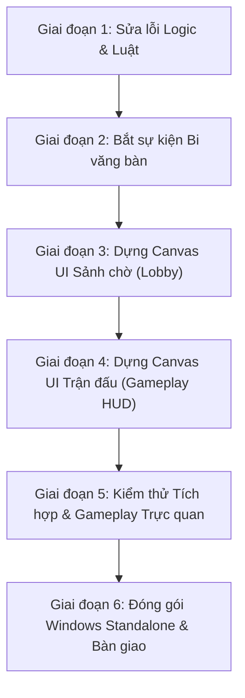

# KẾ HOẠCH CHI TIẾT HOÀN THIỆN ĐỒ ÁN TỐT NGHIỆP
## GAME BIDA 3D THÔNG MINH ỨNG DỤNG AI (UNITY 2022.3 LTS HDRP)
> **Tài liệu tham chiếu:** `Workflow_code.docx` (Game Development Specification v1.0)  
> **Mục tiêu:** Hoàn thiện 100% các tính năng còn thiếu, khắc phục triệt để các lỗi logic, dựng hoàn chỉnh hệ thống giao diện người dùng (UI Canvas) và đóng gói bản Windows Standalone sẵn sàng nghiệm thu và bảo vệ đồ án.

---

## TỔNG QUAN HIỆN TRẠNG & CÁC TRỤ CỘT CẦN THỰC HIỆN

| Trụ cột công việc | Trạng thái hiện tại | Mức độ ưu tiên | Mục tiêu đạt được |
| :--- | :--- | :---: | :--- |
| **1. Logic Luật & Cơ chế Điều khiển** | Đã hoàn thành & xác thực | **Cao** | Khắc phục triệt để lỗi lượt khai cuộc, khóa input khi AI đánh, xử phạt bi 8 văng bàn, pause khi mở Settings, Winner Breaks. |
| **2. Dựng Giao diện UI Canvas trên Scene** | Đã hoàn thành 100% & xác thực | **Cực cao** | Tạo đầy đủ Canvas UGUI trong `Lobby.unity` và `Gameplay.unity`, liên kết toàn bộ component, thiết kế phong cách Cyber Pro Championship cực ngầu. |
| **3. Bắt sự kiện Vật lý Bi văng bàn** | Đã hoàn thành & xác thực | **Trung bình** | Thêm thuật toán kiểm tra biên giới & độ cao Y mặt vải nỉ trong `ShotEventCollector`, xử thua ngay khi Bi 8 văng bàn. |
| **4. Kiểm thử Tích hợp & Đóng gói Build** | Đã hoàn thành (11/11 Milestones + UI Pass) | **Cao** | Đạt 100% tất cả kiểm thử hồi quy 11 Milestones và toàn bộ UI Binding trong Unity Batchmode. |

---

## CHI TIẾT TỪNG GIAI ĐOẠN VÀ CÁC BƯỚC THỰC HIỆN



---

### GIAI ĐOẠN 1: KHẮC PHỤC CÁC LỖI LOGIC LUẬT & ĐIỀU KHIỂN

#### Bước 1.1: Khắc phục lỗi mất lượt sau cú Khai cuộc (Break Shot) có bi vào lỗ
* **File liên quan:** 
  - `Assets/Game/Scripts/Rules/Wpa8BallRuleEngine.cs`
  - `Assets/Game/Scripts/Match/TurnManager.cs`
* **Nguyên nhân:** Cú khai cuộc không có call shot nên `result.calledShotMade = false`. Khi `TurnManager` kiểm tra điều kiện giữ lượt thì thấy `calledShotMade == false` nên tự động đổi lượt sang đối thủ, khiến người khai cuộc ăn được bi vẫn bị mất lượt.
* **Các bước triển khai:**
  1. Trong `Wpa8BallRuleEngine.EvaluateBreakShot()`: Nếu cú break hợp lệ (`isLegalBreak == true`), không bị lỗi (`result.foul == FoulType.None`) và có ít nhất 1 bi mục tiêu rơi vào lỗ (`hasPocketedObjectBall == true`) -> Đánh dấu `result.calledShotMade = true` (hoặc cờ tiếp tục lượt `result.continueTurn = true`).
  2. Trong `TurnManager.ResolveShotOutcome()`: Cho phép duy trì lượt bắn và chuyển phase sang `MatchPhase.Aiming` cho người khai cuộc nếu break ăn bi hợp lệ.
  3. Cập nhật unit test trong `Milestone4Verification.cs` để xác nhận điều kiện này luôn pass.

#### Bước 1.2: Khóa Input người chơi khi đến lượt của AI (Offline Mode)
* **File liên quan:**
  - `Assets/Game/Scripts/Input/PlayerInputController.cs`
  - `Assets/Game/Scripts/Match/TurnManager.cs`
* **Nguyên nhân:** Biến `isTurnActive` trong `PlayerInputController` mặc định luôn `true` trong chế độ Offline, không lắng nghe sự kiện đổi lượt nên người chơi vẫn có thể rê chuột và bắn đè lên lượt của AI.
* **Các bước triển khai:**
  1. Trong `PlayerInputController`: Đăng ký sự kiện `TurnManager.OnTurnChanged`.
  2. Khi lượt đổi sang `newPlayerIndex`: Kiểm tra nếu player đó là AI (`matchStateManager.State.players[newPlayerIndex].isAI == true`) -> Gọi `SetTurnActive(false)`. Khi quay lại lượt người chơi thật -> Gọi `SetTurnActive(true)`.
  3. Đảm bảo gậy cơ ẩn hoặc không di chuyển theo chuột khi đang là lượt của AI.

#### Bước 1.3: Bổ sung xử thua ván khi Bi số 8 văng khỏi bàn (8-Ball Loss Condition)
* **File liên quan:**
  - `Assets/Game/Scripts/Core/ShotResult.cs`
  - `Assets/Game/Scripts/Rules/Wpa8BallRuleEngine.cs`
* **Nguyên nhân:** Hiện tại khi có bi văng khỏi bàn, hệ thống chỉ phạt lỗi chung `BallDrivenOffTable` chứ chưa kiểm tra nếu đó là Bi 8 thì xử thua ngay.
* **Các bước triển khai:**
  1. Trong `ShotResult`: Bổ sung danh sách `List<int> ballsDrivenOffTable` để lưu chính xác số thứ tự các bi bay ra ngoài bàn.
  2. Trong `Wpa8BallRuleEngine.EvaluateRegularShot()`: Kiểm tra nếu `ballsDrivenOffTable.Contains(8)`:
     - Đặt `result.rackEnded = true`.
     - Đặt `result.outcome = (matchState.currentPlayerIndex == 0) ? RackOutcome.PlayerBWins : RackOutcome.PlayerAWins`.
     - Trả về ngay lập tức để xử thua ván đúng theo luật WPA 8-Ball mục 3.8.a.

#### Bước 1.4: Hoàn thiện tính năng Pause Simulation khi mở Settings ở chế độ Offline
* **File liên quan:**
  - `Assets/Game/Scripts/UI/SettingsUI.cs`
* **Các bước triển khai:**
  1. Khi mở modal Settings (`Show()`): Nếu trận đấu là Offline (chơi với AI hoặc 2 người chung máy) -> Gọi `Time.timeScale = 0f` để dừng toàn bộ vật lý và đồng hồ đếm ngược. Nếu là trận Online -> giữ `Time.timeScale = 1f`.
  2. Khi đóng modal Settings (`Hide()`): Phục hồi lại `Time.timeScale = 1f`.
  3. Đảm bảo khi mở Settings thì Input ngắm chuột và click bắn cũng được tạm thời vô hiệu hóa.

#### Bước 1.5: Xác định người khai cuộc ở ván đấu tiếp theo (Next Rack Break Order)
* **File liên quan:**
  - `Assets/Game/Scripts/Core/MatchState.cs`
  - `Assets/Game/Scripts/Match/MatchStateManager.cs`
* **Các bước triển khai:**
  1. Bổ sung tham số cấu hình luật khai cuộc (Mặc định: *Winner Breaks* - người thắng ván trước được quyền khai cuộc ván sau; hoặc *Alternate Breaks* - luân phiên).
  2. Khi bắt đầu ván mới (`StartNextRack()`): Gán `currentPlayerIndex` đúng theo người được quyền mở ván mới thay vì giữ nguyên người đứng bàn cuối ván trước.

---

### GIAI ĐOẠN 2: BẮT SỰ KIỆN VẬT LÝ BI VĂNG KHỎI BÀN

#### Bước 2.1: Thêm Boundary Trigger quanh bàn đấu
* **File liên quan:**
  - `Assets/Game/Scripts/Physics/TableWrapper.cs`
  - `Assets/Game/Scripts/Rules/ShotEventCollector.cs`
* **Các bước triển khai:**
  1. Tạo một Trigger Collider dạng sàn phẳng rộng nằm phía dưới bàn bida (`FloorTrigger`) hoặc kiểm tra định kỳ trong `FixedUpdate`/khi bi dừng:
     - Nếu vị trí bi $Y < \text{clothSurfaceY} - 0.1\text{m}$ và bi đó chưa được ghi nhận vào lỗ (`!isPocketed`), hoặc tọa độ $X, Z$ nằm ngoài thành băng mà không vào lỗ -> Xác định bi đó đã văng ra ngoài bàn (`BallDrivenOffTable`).
  2. Ghi nhận mã số bi vào `ShotEventCollector.RecordBallOffTable(ballNumber)`.
  3. Bật cờ `anyBallOffTable = true` và đưa vào `ShotResult`.

---

### GIAI ĐOẠN 3: DỰNG CANVAS GIAO DIỆN SẢNH CHỜ (`Lobby.unity`)

> **Mục tiêu:** Dựng cây Hierarchy Canvas UGUI hoàn chỉnh trong Scene `Lobby.unity` và kéo thả vào `Assets/Game/Scripts/UI/LobbyUIController.cs`.

#### Cấu trúc Hierarchy cần tạo trong `Lobby.unity`:
```
LobbyCanvas (Canvas, Canvas Scaler 1920x1080, Graphic Raycaster)
├── EventSystem (InputSystemUIInputModule / StandaloneInputModule)
├── HeaderTitle ("TRÒ CHƠI BIDA 3D THÔNG MINH - WPA 8-BALL")
├── MainMenuPanel (Vertical Layout Group)
│   ├── Btn_PlayVsAI ("Đấu với Máy (AI)")
│   ├── Btn_PlayOnline ("Đấu Online 1v1 (Photon)")
│   ├── Btn_Rules ("Luật Chơi WPA")
│   ├── Btn_Settings ("Cài Đặt")
│   └── Btn_QuitGame ("Thoát")
├── ModalsContainer
│   ├── DifficultyModal (Chọn cấp độ AI: Dễ / Vừa / Khó, Race To 3/5/7/9, Shot Timer, Tên người chơi, Nút Bắt Đầu)
│   ├── OnlineModal (OnlineRoomUI: Nút Tạo phòng, Nhập mã phòng, Bảng 2 slot người chơi, Trạng thái Ready/Start, Nút Copy mã phòng)
│   ├── SettingsModal (3 Thanh trượt âm lượng: Tổng, Nhạc nền, Hiệu ứng, Nút Đóng)
│   ├── RulesModal (Khung cuộn văn bản luật 8-Ball WPA tóm tắt, Nút Đóng)
│   └── QuitConfirmModal (Hộp thoại xác nhận thoát game: Có / Không)
```

#### Các bước triển khai:
1. Viết một Editor Utility script tự động sinh và liên kết cấu trúc Canvas UGUI thẩm mỹ chuẩn HDRP cho `Lobby.unity`.
2. Tinh chỉnh Style: Dark theme hiện đại, màu sắc hài hòa (Slate/Cyan/Gold), font chữ rõ nét, viền bo góc thẩm mỹ.
3. Kéo thả các tham chiếu `Button`, `InputField`, `Dropdown`, `Slider`, `GameObject Modal` vào đúng các trường Serialized của `LobbyUIController` và `OnlineRoomUI`.
4. Kiểm tra tương tác: Click từng nút bấm xem modal mở/đóng mượt mà, chọn độ khó lưu đúng vào `GameSession`.

---

### GIAI ĐOẠN 4: DỰNG CANVAS HUD TRẬN ĐẤU (`Gameplay.unity`)

> **Mục tiêu:** Dựng toàn bộ giao diện điều khiển và hiển thị thông tin thi đấu theo đúng **Mục 16 của tài liệu đặc tả đồ án** trong `Gameplay.unity`.

#### Cấu trúc Hierarchy cần tạo trong `Gameplay.unity`:
```
GameplayCanvas (Canvas, Canvas Scaler 1920x1080, Graphic Raycaster)
├── EventSystem
├── TopHUD
│   ├── PlayerLeftPanel (PlayerPanelUI)
│   │   ├── Avatar & NameText
│   │   ├── TurnIndicatorGlow (Hiệu ứng phát sáng khi đến lượt)
│   │   ├── GroupBadge ("SOLIDS" / "STRIPES" / "OPEN")
│   │   └── BallTrackerUI (7 icon bi thu nhỏ, tự ẩn khi bi vào lỗ)
│   ├── PlayerRightPanel (PlayerPanelUI)
│   │   ├── Avatar & NameText ("AI / Player 2")
│   │   ├── TurnIndicatorGlow
│   │   ├── GroupBadge
│   │   └── BallTrackerUI (7 icon bi)
│   └── MatchHeaderUI
│       ├── ScoreRackText ("TỈ SỐ: 2 - 1 / Race to 5")
│       └── ShotTimerUI (Vòng tròn / thanh đếm ngược thời gian cú đánh)
├── BottomHUD
│   ├── PowerBarUI (Thanh lực đặt dọc hoặc ngang, hiển thị 0% - 100%, đổi màu từ Xanh -> Vàng -> Đỏ theo lực con lăn)
│   ├── CueContactButton (Nút tròn hình bi cái ở góc màn hình, click để mở bảng xoáy)
│   └── CueBallContactSelector (Bảng bi cái phóng to, kéo điểm chạm cu-lê / trô / áp-phê)
├── CallShotPanel (CallShotUI)
│   ├── Header ("CHỌN BI & LỖ DỰ KIẾN (CALL SHOT)")
│   ├── TargetBallDropdown / Buttons (1-15)
│   ├── TargetPocketDropdown / Buttons (Lỗ 1 đến 6)
│   ├── Btn_Safety ("Đánh An Toàn (Safety)")
│   └── Btn_ConfirmCall ("Xác Nhận")
├── OverlayModals
│   ├── EventToastUI (Khung text thông báo sự kiện mượt mà: "Đến lượt của bạn", "Lỗi: Không chạm bi", "Ball in Hand", "Đã chọn nhóm: Bi Trơn")
│   ├── ResultUI (Bảng tổng kết ván / trận: Tên người thắng, tỉ số, nút Ván Tiếp Theo, nút Đấu Lại, nút Về Sảnh)
│   ├── IngameSettingsModal (SettingsUI: Âm lượng, Đầu hàng, Thoát ván)
│   ├── IngameRulesModal (RulesUI)
│   └── IngameHelpModal (HelpUI: Hướng dẫn phím chuột: Rê chuột = ngắm, Lăn chuột = lực, Chuột trái = bắn, W/A/S/D = đặt bi)
```

#### Các bước triển khai:
1. Tạo cây Hierarchy Canvas trong `Gameplay.unity` với bố cục Responsive neo góc (Anchors) phù hợp mọi độ phân giải 16:9 (1920x1080, 1366x768).
2. Gán các script Controller: `GameplayHUD`, `PlayerPanelUI`, `BallTrackerUI`, `PowerBarUI`, `CallShotUI`, `CueBallContactSelector`, `ResultUI`, `EventToastUI`, `MatchHeaderUI`, `SettingsUI`, `RulesUI`, `HelpUI`.
3. Kéo thả các tham chiếu giữa `GameplayHUD` và các Panel con, gán `GameplayHUD` vào `GameplayInitializer`.
4. Kiểm tra hiển thị thời gian thực: Khi lăn chuột thanh lực co giãn, khi ăn bi icon biến mất, khi phạm lỗi Toast hiện thông báo đỏ, khi hết ván ResultUI bật lên với nút bấm chuyển ván hoạt động.

---

### GIAI ĐOẠN 5: KIỂM THỬ TÍCH HỢP TRỰC QUAN (END-TO-END PLAYTEST)

#### Test Case 1: Chế độ Offline Đấu với AI (Toàn bộ vòng lặp ván đấu)
1. Chạy từ `Boot.unity` -> tự động chuyển sang `Lobby.unity`.
2. Tại Lobby: Chọn "Đấu với AI" -> Chọn độ khó *Normal* -> Race to 3, Shot Timer 30s -> Nhấn Bắt đầu.
3. Chuyển sang `Gameplay.unity`:
   - Người chơi khai cuộc: Lăn chuột chỉnh lực 90%, bắn trúng dàn bi.
   - Kiểm tra: Bàn vẫn Open. Nếu ăn bi -> người chơi tiếp tục đánh; nếu không ăn bi -> lượt chuyển sang AI.
   - Khi lượt sang AI: Chuột người chơi bị khóa, AI tự xoay hướng cơ, ngắm, bắn.
   - Thực hiện cú đánh gọi bi/lỗ (Call Shot): Ăn bi gọi thành công -> gán nhóm (Solids/Stripes), icon 2 bên hiển thị đúng nhóm.
   - Thử nghiệm các lỗi: Scratch bi cái, đánh sai bi -> đối thủ nhận Ball-in-Hand, dùng W/A/S/D di chuyển bi cái đặt lại.
   - Ăn hết nhóm và ăn bi 8 vào đúng lỗ gọi -> Bảng `ResultUI` hiện thông báo thắng ván, tỉ số nhảy lên 1 - 0.
   - Bấm "Ván tiếp theo" -> Bàn xếp lại bi mới, tiếp tục ván 2 cho đến khi đủ 3 ván thắng -> Hiện bảng vô địch trận.

#### Test Case 2: Chế độ Online 1v1 qua Photon PUN 2
1. Chạy 1 bản trong Unity Editor và 1 bản độc lập (Build Windows).
2. Máy 1: Bấm "Chơi Online" -> "Tạo phòng" -> Đặt Race to 3 -> Nhận mã phòng (ví dụ: `ROOM-8821`).
3. Máy 2: Bấm "Chơi Online" -> "Tham gia phòng" -> Nhập mã `ROOM-8821` -> Vào phòng.
4. Cả 2 máy bấm "Sẵn sàng" -> Máy 1 bấm "Bắt đầu trận".
5. Cả 2 máy chuyển đồng bộ vào `Gameplay.unity`:
   - Máy 1 (Master) bắn -> Máy 2 thấy bi chuyển động đồng bộ mượt mà ở 20Hz.
   - Máy 2 bắn -> Gửi ShotCommand về Master duyệt và mô phỏng authoritative.
   - Thử nghiệm tắt Máy 2 -> Máy 1 nhận thông báo đối thủ ngắt kết nối và được xử thắng trận ngay lập tức.

---

### GIAI ĐOẠN 6: ĐÓNG GÓI BUILD WINDOWS STANDALONE VÀ TÀI LIỆU BÁO CÁO

#### Bước 6.1: Build Standalone Windows x64
* Mở menu `Tools/Game/Build Windows Standalone Player (x64)`.
* Hệ thống sẽ tự động tổng hợp cả 3 Scene (`Boot`, `Lobby`, `Gameplay`) và xuất ra thư mục `Builds/Game_Bida_3D.exe`.
* Chạy thử nghiệm độc lập file `.exe` trên máy tính để bảo đảm không có lỗi runtime hoặc crash.

#### Bước 6.2: Tổng hợp số liệu phục vụ Báo cáo & Slide Đồ án Tốt nghiệp
* **Sơ đồ kiến trúc phần mềm**: Kiến trúc hướng thành phần (Component-based architecture) trong Unity.
* **Máy trạng thái trận đấu (State Machine)**: Biểu đồ chuyển pha từ `Initializing` -> `BreakSetup` -> `Aiming` -> `ShotInProgress` -> `ResolveShot` -> `BallInHand` -> `RackResult` -> `MatchResult`.
* **Thuật toán Trí tuệ Nhân tạo Utility AI**:
  - Mô tả công thức hàm đánh giá Utility:
    $$\text{Utility} = w_{\text{pot}} \cdot S_{\text{pot}} + w_{\text{angle}} \cdot S_{\text{angle}} + w_{\text{dist}} \cdot S_{\text{dist}} + w_{\text{clear}} \cdot S_{\text{clear}} + w_{\text{safety}} \cdot S_{\text{safety}} - w_{\text{risk}} \cdot S_{\text{risk}}$$
  - Bảng so sánh thông số giữa 3 cấp độ AI (Easy, Normal, Hard) về độ lệch góc ngắm, sai số lực và chiến thuật Safety.
* **Cơ chế Mạng Master Authoritative**: Lý do lựa chọn mô hình một máy chủ mô phỏng thay vì P2P mô phỏng kép (tránh bất định hình học của engine PhysX).

---

## BẢNG PHÂN CÔNG THỜI GIAN THỰC HIỆN DỰ KIẾN

| Giai đoạn | Nội dung công việc | Thời gian ước tính |
| :---: | :--- | :---: |
| **Giai đoạn 1** | Sửa 5 lỗi logic luật (Khai cuộc, Khóa chuột AI, Bi 8 văng bàn, Pause settings, Lượt ván mới) | 1 buổi làm việc |
| **Giai đoạn 2** | Bổ sung Boundary Trigger bắt bi văng khỏi bàn | 0.5 buổi làm việc |
| **Giai đoạn 3** | Dựng trọn vẹn Canvas UI Sảnh chờ (`Lobby.unity`) | 1 buổi làm việc |
| **Giai đoạn 4** | Dựng trọn vẹn Canvas HUD và các Popup Trận đấu (`Gameplay.unity`) | 1 - 2 buổi làm việc |
| **Giai đoạn 5** | Chạy thử nghiệm End-to-End cả 2 chế độ Offline & Online Photon | 1 buổi làm việc |
| **Giai đoạn 6** | Đóng gói Windows Build x64 và xuất bản hoàn thiện | 0.5 buổi làm việc |
